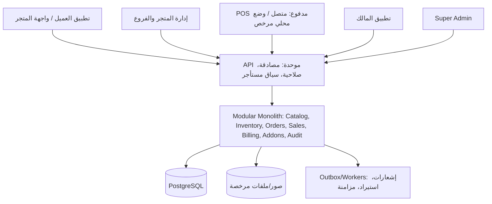
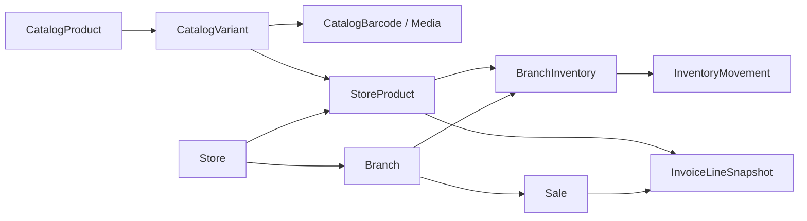

# منصة السوبر ماركت متعددة المتاجر — الوثيقة التنفيذية الموحدة (الإصدار 3.0)

**التاريخ: 16 أكتوبر 2026**  
**الوضع: متطلبات معتمدة للنقاش والتخطيط؛ لا توجد نتائج تنفيذ أو اختبارات مثبتة.**

## فهرس الملفات المضمّنة

1. `README_AR.md`
2. `CODEX_MASTER_PROMPT_AR.md`
3. `DECISION_REGISTER_AR.md`
4. `PRODUCT_REQUIREMENTS_AR.md`
5. `CENTRAL_CATALOG_SPEC_AR.md`
6. `SYSTEM_ARCHITECTURE_AR.md`
7. `UX_UI_GUIDELINES_AR.md`
8. `BUSINESS_MODEL_AR.md`
9. `GITHUB_REPOSITORY_EVALUATION_AR.md`
10. `ACCEPTANCE_TEST_MATRIX_AR.md`
11. `EXECUTION_GOVERNANCE_AR.md`
12. `REVISION_NOTES_AR.md`

---

---

# القسم 1: README_AR.md

# حزمة مواصفات منصة السوبر ماركت — الإصدار 3.0

**التاريخ:** 16 أكتوبر 2026 | **الحالة:** مواصفات جاهزة للمراجعة الفنية، وليست برنامجًا مطورًا.

## فكرة المنصة في سطرين

نظام SaaS متعدد المستأجرين والمتاجر والفروع، بخمس تجارب استخدام واشتراكات وإضافات POS وAI Analytics مستقلة. **الميزة الأساسية المعتمدة حديثًا:** كتالوج مركزي موثوق يضيف منه التاجر أصنافه بالسعر والمخزون فقط، مع Excel/CSV والباركود، ومنتجات خاصة عند الحاجة، دون العبث بتاريخ البيع.

## ترتيب القراءة الموصى به لـ Codex

1. `CODEX_MASTER_PROMPT_AR.md` — الحوكمة والمهمة وحدود التفويض.
2. `DECISION_REGISTER_AR.md` — ما تم الاتفاق عليه وما بقي مفتوحًا.
3. `PRODUCT_REQUIREMENTS_AR.md` — النطاق التجاري والوظائف وقواعد الأعمال.
4. `CENTRAL_CATALOG_SPEC_AR.md` — مواصفات الكتالوج والشاشات والاستيراد والجودة.
5. `SYSTEM_ARCHITECTURE_AR.md` — نموذج البيانات والفصل والمعاملات والتزامن.
6. `UX_UI_GUIDELINES_AR.md` — التصور الوظيفي للشاشات وتجربة التاجر.
7. `BUSINESS_MODEL_AR.md` — الاشتراكات والتكاليف واقتصاديات الكتالوج.
8. `GITHUB_REPOSITORY_EVALUATION_AR.md` — سياسة تقييم المستودعات والرخص.
9. `ACCEPTANCE_TEST_MATRIX_AR.md` — شروط الاختبارات والإطلاق.
10. `EXECUTION_GOVERNANCE_AR.md` — مراحل التنفيذ وبوابات الموافقة.
11. `REVISION_NOTES_AR.md` — الفرق عن الإصدار 2.0.

## تعليمات حاكمة

- **هذه الحزمة لا تعطي إذنًا بالدخول إلى مشروع `supermarket` أو تعديل GitHub أو تنفيذ كود.** أي فحص مستودع يستلزم تفويض قراءة، وأي كتابة/نشر يستلزم موافقة تنفيذ منفصلة.
- عند السماح بالتقييم لاحقًا: افحص الموجود أولًا، ثم مصادر Github وتراخيصها وتوافقها وحقوق الصور/بيانات الكتالوج؛ لا تفترض أن المستودع فارغ.
- عند كتابة النظام بعد إذن: الكتالوج هو مرجع عالمي، بينما سعر التاجر والمخزون الفرعي وبيانات العملاء والعمليات المالية معزولة.
- لا يجوز نسب نجاح تنفيذ أو اختبار لأي وظيفة من هذه الوثائق وحدها.

## نص قصير للتكليف الاستكشافي لاحقًا بعد إعطاء صلاحية القراءة

> اقرأ جميع ملفات هذه الحزمة، وابدأ بعرض فهم موحد للمشروع والقرارات المفتوحة. بعد الحصول على إذن قراءة صريح، افحص مشروع `supermarket` وقيّم بدائل GitHub وتراخيص الكود والأصول والبيانات. لا تنشئ أو تعدل ملفات مشروع، ولا تنفذ أو تنشر أو تثبت شيئًا. قدم تقرير فجوات ومعمارية ونطاق MVP، مع إعطاء أولوية للكتالوج المركزي والتحقق من فصل السعر والمخزون والفواتير التاريخية، ثم انتظر إذن التنفيذ.

---

# القسم 2: CODEX_MASTER_PROMPT_AR.md

# التعليمات الرئيسية لمنصة السوبر ماركت متعددة المتاجر

**المشروع:** Supermarket SaaS Platform  
**الإصدار:** 3.0 — مواصفات منقحة للنقاش والاعتماد  
**اللغة:** العربية افتراضيًا (RTL) مع جاهزية الترجمة  
**نوع المنتج:** منصة SaaS متعددة المستأجرين والمتاجر والفروع، مع إضافات مدفوعة مستقلة  
**الحالة:** وثيقة متطلبات وليست كودًا أو دليلًا على اكتمال النظام

> **قيد العمل الحالي:** هذه الوثيقة لا تمنح أي إذن بالدخول إلى GitHub أو تعديل المستودع أو تثبيت حزم أو تشغيل أو نشر خدمات. عند تسليمها إلى Codex، تكون أول مهمة **القراءة والتقييم والتوصية** فقط؛ لا يبدأ التنفيذ والتغييرات إلا بتفويض منفصل وصريح من مالك المشروع يحدد النطاق.

## 1. المهمة والهدف التجاري

تصرّف كفريق متكامل يضم إدارة منتج، تحليل أعمال SaaS، هندسة معماريات، Backend، Web، Mobile، UX/UI، أمن، اختبار، تشغيل، وقابلية دعم. الهدف بناء منتج فعلي يتيح لمتجر صغير البدء بسرعة، ولسلسلة متاجر إدارة فروعها، ولمالك المنصة بيع الاشتراكات والإضافات بصورة مربحة وقابلة للمحاسبة.

المبادئ غير القابلة للتفاوض:

1. دورة بيع ومخزون صحيحة أهم من كثرة الشاشات.
2. لا يستطيع مستأجر الاطلاع على بيانات غيره؛ ولا يستطيع موظف الاطلاع على فرع أو وظيفة خارج صلاحياته.
3. وظائف الإضافات المدفوعة محمية في الخادم، لا بإخفاء الأزرار فقط.
4. تجربة عربية سهلة وسريعة للكاشير ولصاحب المتجر والعميل.
5. العمليات النقدية والآجلة والمحافظ والاسترجاع تُسجل كسجلات حركة قابلة للمراجعة، وليس بتعديل أرصدة خام.
6. لا يُقال «مكتمل» أو «جاهز للإطلاق» دون اختبار موثق لنطاق محدد.
7. ابدأ بـ **Modular Monolith** وبأبسط عدد معقول من التطبيقات القابلة للنشر، ولا تبدأ بـ Microservices إلا بمبرر موثق.
8. أسعار البيع والاشتراك، الفروع، العملات، والخصائص التجارية قابلة للضبط وفق الصلاحيات؛ ولا توضع افتراضات تجارية صلبة داخل الكود.
9. لا مدفوعات تلقائية وهمية، ولا ذكاء اصطناعي ينتج بيانات مصطنعة، ولا افتراض لاستقرار الإنترنت.
10. لا تغيير مدمر دون موافقة وخطة نسخ احتياطي واستعادة، ولا خدمة مدفوعة دون تفويض.

## 2. نقطة البداية الحقيقية: مشروع `supermarket`

ورد في المواصفات الأولية أن المشروع جديد، وورد أيضًا أن مشروعًا باسم `supermarket` قد أُنشئ. **هذه ليست موافقة على افتراض حالته.** اعتبره *مستودعًا محتملًا* غير معروف المحتوى إلى أن يؤذن بفحصه.

عند الإذن بالمرحلة الاستكشافية:

1. تحقق من رابط/هوية المستودع الصحيح وأنه متعلق بهذا المشروع.
2. افحص المحتوى وREADME والترخيص والتقنيات والفروع وسجل التغييرات وملفات البيئة **للقراءة فقط**.
3. صنّفه: فارغ / تأسيس مبدئي / مشروع قائم / غير ذي صلة، مع دليل.
4. قبل نسخ أو استبدال أي شيء، قارن بين البناء فوق الموجود واعتماد أساس مفتوح المصدر والبدء من الصفر.
5. ابحث عن مستودعات GitHub المرشحة، وافحص تراخيص الكود والأصول والتبعيات، والنضج، وآليات العزل وPOS، والاستقرار والاختبارات.
6. قدّم `REPOSITORY_ASSESSMENT.md` كتقرير مقترح **بعد الإذن بإنشاء الملفات**، أو قدّم التقرير نصيًا في المحادثة إذا كان التفويض للقراءة وحدها.
7. لا تدمج أكواد من مشاريع ذات تراخيص متعارضة، ولا تفترض أن النشر العلني يتيح الاستخدام التجاري.

**قاعدة اختيار أساس المشروع:** الترخيص السليم والتوافق القانوني شرط قبول، ثم صحة العمليات والأمن وقابلية التطوير؛ النجوم على GitHub ليست معيارًا كافيًا. لا تغيّر إطارًا تقنيًا دون تحليل التكلفة والمخاطر والموافقة على التحول.

## 3. الحدود التجارية: المستأجر والمتجر والفرع

اعتمد هذا التفريق المفاهيمي في التصميم، مع فحص ملاءمته قبل تثبيت مخطط البيانات:

- **Tenant / حساب المستأجر:** الجهة التعاقدية التي تتحمل الاشتراك وتدير مستخدميها.
- **Store / المتجر أو العلامة:** كيان تجاري له هوية وقائمة منتجات وعروض وسياسات، وقد يمتلك فرعًا واحدًا أو أكثر.
- **Branch / الفرع:** نقطة بيع/مخزن/موقع تشغيل لها مخزون وحركات وورديات مستقلة، ويمكن جمع تقاريرها بحسب الصلاحيات.
- **User & Membership:** مستخدم قد تكون له عضويات وأدوار مختلفة في متاجر وفروع مختلفة؛ لا يُمنح الوصول بمجرد معرفة المعرّف.

**سياسة افتراضية مقترحة:** تبدأ الباقة بمتجر وفرع واحد، وتُفعل الفروع أو المتاجر الإضافية حسب الاشتراك. لا يفترض أن مالك فرع يستطيع مشاهدة فروع أخرى إلا بصلاحية صريحة. تُحدد جهة الفوترة والسعر النهائي لاحقًا ضمن مصفوفة الباقات.

يجب تصميم تحويل مخزون بين الفروع، وتقرير إجمالي للفروع، ومنع تجاوز أرصدة الفروع ومزج المخزون بينها بلا حركة موثقة.

## 4. التقنية والبنية الموصى بها

**Backend:** Node.js + TypeScript + Express + Prisma + PostgreSQL، وOpenAPI لتوثيق عقود API.  
**Web:** React + Vite + TypeScript.  
**Mobile:** React Native + Expo + TypeScript إذا لم تمنع المتطلبات الفعلية لبعض الأجهزة ذلك.  
**اختبارات:** Unit، Integration، End-to-End، عقود API، عزل متعدد المستأجرين، فشل الشبكة، ونسخ احتياطي/استعادة.

### لا تخلط بين «خمس تجارب مستخدم» و«خمسة مشاريع مستقلة»

الواجهات الخمس المستهدفة ثابتة **وظيفيًا**:

1. تطبيق العميل.
2. واجهة الكاشير POS المدفوعة.
3. إدارة المتجر.
4. تطبيق مالك المتجر.
5. لوحة Super Admin.

لكن **التنفيذ الموصى به لتقليل التكلفة**: Backend واحد منظم بوحدات؛ واجهة ويب واحدة قابلة لاستضافة مساحات دورية معزولة (الإدارة، POS، مالك المنصة)؛ وتطبيقا جوال فقط إذا أظهرت تجربة الاستخدام ضرورة الاحتفاظ بكليهما. شارك الحزم والأنواع وتصميم الواجهة عند الإمكان، من دون مزج الصلاحيات أو بيانات المستأجرين. يجوز أن يصبح POS تطبيقًا مخصصًا على جهاز المتجر إذا أثبت تقييم العمل دون إنترنت والأجهزة الطرفية الحاجة إلى ذلك.

**اقتراح حدود الوحدات:** Identity & RBAC، Tenancy/Stores/Branches، Catalog، Inventory، Procurement، Customers، Orders، Sales، POS Add-on، Receivables & Store Credit، Subscriptions & Billing، Add-on Entitlements، Promotions، Reporting، Notifications، AI Analytics، Audit & Operations.

## 5. الوظائف الأساسية والإضافات: فصل صريح

النواة المشمولة بالاشتراك المناسب:

- إنشاء المتجر، الفرع الأول، المستخدمين والصلاحيات، الهوية التجارية.
- كتالوج المنتجات والمخزون والمشتريات والموردين والعملاء.
- استلام طلبات العملاء ومعالجتها من الإدارة.
- تقارير تشغيلية أساسية ومراقبة الاشتراك، وفق الباقة.

**POS إضافة مستقلة:** البيع السريع عبر الكاشير، الورديات، ماسح الباركود، درج النقد، طباعة الإيصالات، المرتجعات الخاصة بالكاشير، وآلية عدم الاتصال المعتمدة. **عدم اشتراك المتجر في POS لا يعطّل التجارة الإلكترونية أو إدارة الطلبات والمخزون.** لكن يمنع في الخادم أي عملية بيع مخصصة لمسار POS إذا لم يكن الاستحقاق ساريًا.

**AI Analytics إضافة مستقلة:** تلخيص وتحليل وتنبؤ مدعوم ببيانات حقيقية، محكوم بالاستهلاك والتكلفة؛ ولا يتولى تنفيذ تغييرات مالية أو شرائية تلقائيًا.

إضافات مستقبلية: الولاء، تقارير موسعة، مشتريات متقدمة، إدارة فروع متقدمة، تكامل الدفع/التوصيل. لا تحول ميزة جوهرية إلى إضافة فقط لزيادة الإيرادات إذا كان ذلك يكسر دورة العمل الأساسية.

## 5أ. الكتالوج المركزي الذكي — قرار أساسي معتمد

**اقرأ `CENTRAL_CATALOG_SPEC_AR.md` كاملًا قبل أي تصميم للمنتجات أو المخزون.** ليس الكتالوج المركزي متجرًا ولا مخزونًا ولا قائمة أسعار موحدة، بل بيانات تعريف مرجعية للمنتجات/المتغيرات والعبوات وصورها المرخصة وأكوادها وتصنيفاتها.

- Super Admin ينشئ/يراجع/ينشر المنتجات المرجعية مرة واحدة. التاجر يختارها ليضيف **سعر متجره ومخزونًا افتتاحيًا لفرعه لأول مرة**، دون إعادة الاسم والصورة.
- دعم اختيار جماعي لـ100 صنف أو أكثر في واجهة مهيأة، وتنزيل XLSX افتراضيًا ببيانات الأصناف الثابتة وأعمدة اختيار/سعر/كمية، ورفع XLSX أو CSV، والماسح الضوئي للباركود. لا تعتمد على الصفوف المخفية في Excel كإشارة حذف.
- التاجر يستطيع إنشاء منتج خاص لا يراه متجر آخر؛ يمكنه **اقتراح** نشره مركزيًا بعد مراجعة، لا نشره دون موافقة.
- لا دمج منتجات متشابهة عند الالتباس، خصوصًا اختلاف العبوة/الحجم/العلامة/نوع الباركود. حماية صور المنتجات وحقوق إعادة استخدامها شرط نشر.
- الكتالوج يملك معرفات ثابتة وسجل نسخ/تغييرات وآلية aliases للمكررات؛ لا تحول «منتج 1 لتر» إلى «منتج 200 مل» بتعديل هوية السجل القديم.
- **الفواتير تحفظ snapshots ثابتة**. استيراد منتج موجود لا يعيد تطبيق كمية افتتاحية؛ الافتراضي «تجاوز»، وتحديث السعر قرار صريح، وتعديل المخزون يتم بالجرد/التسوية المدققة.
- في كل استيراد: تحقق صلاحيات المتجر/الفرع، منع التكرار عبر معرف الطلب، معاينة قبل الاعتماد، ونتيجة تفصيلية للمقبول/المتجاوز/المرفوض. لا نجاح وهمي.
- لا تجعل جودة الكتالوج تعتمد على اشتراك AI المدفوع. يمكن استخدام AI للمقترحات، لكن قواعد المطابقة والتفويض والموافقة الأساسية حتمية.

**مراجع التنفيذ والاختبار:** `CENTRAL_CATALOG_SPEC_AR.md`، `SYSTEM_ARCHITECTURE_AR.md`، `ACCEPTANCE_TEST_MATRIX_AR.md` و`DECISION_REGISTER_AR.md`.

## 6. خصائص السوبر ماركت التي يجب تصميمها منذ البداية

- الأصناف الموزونة (كيلوغرام/غرام)، والمباعة بالحبة أو الصندوق والكرتون، وتحويلات وحدات دقيقة.
- تعدد باركود المنتج، وSKU داخلي، والباركود الوزني/السعري المطبوع من الميزان **وفق تنسيقات قابلة للتهيئة والاختبار مع أجهزة فعلية**.
- دفعات التشغيلات `Lots/Batches` وتواريخ الإنتاج والصلاحية عند الحاجة، وتتبع FEFO/FIFO عندما يكون مناسبًا.
- الجرد والتسويات والتالف والفاقد والتحويل بين الفروع، مع أسباب وأدلة وصلاحيات.
- عروض الخصم على منتج أو مجموعة أو حزمة، ومنع التعارضات والخصومات غير المصرح بها.
- شراء بالوحدة/الكرتون والبيع بالوحدة/الوزن، وتكلفة مرجعية محددة لا تُستنتج عشوائيًا.
- المنتجات المؤرشفة تبقى في الفواتير والحركات التاريخية.

**ممنوع الاعتماد على أعداد عشريّة عائمة لحساب الأموال.** تُستخدم تمثيلات دقيقة للعملات والكميات مع قواعد تقريب معلنة واختبارات حالات الحدود، وفصل وحدة الكمية عن وحدة النقد.

## 7. العمل عند انقطاع الإنترنت: قرار منتج لا تفصيل شكلي

البيئة المستهدفة قد تتعرض لانقطاع الشبكة. على الفريق تقييم بدائل تشغيل POS: PWA بمخزن محلي معتمد، أو عميل سطح مكتب خاص إذا كان أكثر موثوقية مع الأجهزة، أو تشغيل online-first كنسخة تجريبية **معلن بوضوح أنه لا يدعم البيع دون اتصال**.

**المعيار قبل إطلاق POS التجاري في سوق يتطلب العمل دون إنترنت:**

1. بيان الوظائف المسموحة دون اتصال والوظائف المحظورة. الافتراضي: لا محفظة، لا آجل جديد، لا استرجاع/إلغاء معقد، ولا تغيير سعر/صلاحية دون تحقق موثوق؛ وقد يقتصر البيع على النقد.
2. حفظ العمليات المحلية بصورة متينة وآمنة على الجهاز مع معرف عملية فريد، وطابع زمني، وهوية الكاشير، ومرجع الوردية، وحالة «بانتظار المزامنة».
3. عدم إظهار العملية غير المتزامنة وكأن الخادم أكدها. يجب التمييز بين «تمت محليًا» و«تمت مزامنتها» و«تحتاج معالجة».
4. وضع سياسة معروفة لمخاطر تعارض المخزون والأسعار عند بيع عدة أجهزة دون اتصال؛ لا تعد بمخزون موحد لحظيًا أثناء الانقطاع.
5. مزامنة idempotent، واعتراض التكرار، وتسوية التعارضات بتوثيق وصلاحية ومراجعة بشرية عند الحاجة.
6. تحديد صلاحية الاستحقاقات المخزنة مؤقتًا وآلية إيقاف الأجهزة المفقودة، مع موازنة استمرارية البيع والأمن.
7. اختبار انقطاع الشبكة أثناء الدفع، وإعادة تشغيل الجهاز، وتعدد الكاشيرات، وانتهاء الجلسة والاشتراك، واستعادة الخدمة.

**بوابة إطلاق:** يمكن بدء تجربة داخلية بنظام online-only مع تحذير صريح. لا يُسوَّق نظام POS على أنه يدعم العمل دون اتصال قبل اجتياز اختبار الواقعية على الأجهزة المعتمدة.

## 8. الحسابات والآجل والمحفظة

- **الذمم المدينة (الآجل):** دين على العميل، له حد ائتماني وسجل بيع وتحصيل وتسوية، وليس محفظة.
- **رصيد المتجر/الائتمان المسبق (Store Credit):** التزام على المتجر تجاه العميل، تنشأ له حركة إيداع/استهلاك/استرجاع؛ لا يساوي محفظة دفع قابلة للتحويل.
- **محفظة دفع خارجية:** تكامل منفصل مع مزود معتمد، بعد تقييم قانوني وأمني وتقني؛ لا ينشئ النظام افتراضيًا حفظ أموال قابلة للسحب أو التحويل.

أي تعديل رصيد يجب أن ينتج عن قيود/حركات دقيقة وقابلة للتتبع داخل معاملة قاعدة بيانات. عمليات البيع والتحصيل والاسترداد والمزامنة يجب أن تكون آمنة ضد التكرار، وأن تحقق تسوية واضحة بين النقد والمبيعات والذمم.

## 9. الهوية التجارية White-Label

**المرحلة الأولى:** تخصيص الشعار والألوان واسم المتجر وصوره ضمن تطبيق عميل مشترك أو تجربة ويب محددة المتجر (بواسطة رابط/رمز اختيار موثوق) مع عزل كامل للمنتجات والعملاء والعروض. لا يرى العميل عروض متجر آخر في تجربة المتجر النشط.

**اختيارات لاحقة بعرض اقتصادي منفصل:** نطاقات مخصصة، وتطبيق جوال مستقل لكل متجر منشور باسمه. لا تعد بتطبيقات منفصلة للمتاجر ضمن سعر الاشتراك الأساسي قبل تقدير تكلفة البناء والحسابات والنشر والتحديث والدعم.

## 10. عزل البيانات، الأمن، والتدقيق

- هوية المستأجر والمتجر والفرع الفعال مشتقة من مصادقة موثوقة وعضوية مفوضة؛ لا تثق بـ `tenantId` أو `storeId` أو `branchId` الوارد من العميل وحده.
- تحقق من الاستحقاق والصلاحية والموارد على الخادم في كل API، وفي المهام الخلفية والتقارير والتصدير والملفات والبحث.
- فكر في سياسات PostgreSQL Row-Level Security كطبقة دفاع إضافية إن سمحت المعمارية، لا كبديل عن التفويض في التطبيق.
- استخدم التجزئة الآمنة لكلمات المرور؛ آليات استعادة حساب ومصادقة وجلسات مع حدود للمحاولات؛ وإدارة أسرار مناسبة.
- تعامل مع كل عملية مالية/مخزنية حساسة كمعاملة ذرية، مع idempotency وسجل تدقيق غير قابل للتعديل بسهولة.
- قيّد تصدير البيانات والوصول إلى صور المنتجات والمرفقات ومسارات الملفات حسب المستأجر والعضوية.
- دوّن حالات فشل المزامنة والاتصال دون تسجيل كلمات مرور أو توكنات أو بيانات مالية حساسة تفصيلية في السجلات.
- ضع سياسة نسخ احتياطي واستعادة فعلية ومختبرة، واحتفاظ وحذف وتصدير بيانات عند إنهاء الاشتراك وفق سياسة معلنة.

## 11. الباقات، المدفوعات، والإضافات

الباقات المقترحة: **أساسية، احترافية، مؤسسات**؛ الأسعار والعملة والفروع والمستخدمون والحدود والتجربة ودورة الفوترة قابلة للتعديل من Super Admin، دون أرقام مفروضة في الكود.

**تسلسل الدفع اليدوي:** طلب اشتراك/إضافة ← فاتورة/تعليمات واضحة ← إثبات أو تسجيل دفع بانتظار التحقق ← مراجعة مسؤول مفوض ← تأكيد دفع موثق ← تفعيل استحقاق محدد ومؤرخ ← إشعار وسجل تدقيق. لا تساوِ بين رفع إيصال ووصول الأموال. افصل حالة الاشتراك الأساسي عن كل إضافة؛ لا تحذف البيانات عند انتهاء الاشتراك أو الإضافة تلقائيًا، وأبقِ الوصول الضروري للتصدير بحسب السياسة.

السعر الجديد لا يعيد كتابة فواتير قديمة؛ استخدم إصدارات أو لقطات الأسعار، وتاريخ سريان واضح للاشتراكات القائمة. راقب تكلفة الاستضافة لكل مستأجر، ودعم العملاء، والإشعارات، والنسخ الاحتياطي، وخدمات AI، وتجديد الاشتراك والإلغاء.

## 12. الذكاء الاصطناعي المدفوع

- يبدأ التحليل من استعلامات وأرقام وحسابات قابلة للتحقق؛ يقوم النموذج بتفسير **النتائج الفعلية** وليس باختلاقها.
- أظهر الفترة والمنطقة الزمنية والفرع/المتجر ومصدر البيانات، وجودتها وحدود التوقع.
- التوقعات بحاجة حد أدنى معقول من السجل التاريخي، وإلا اعرض «بيانات غير كافية».
- لا تعرض «صافي الربح» دون سياسة واضحة لتكلفة البضاعة والخصومات والمرتجعات والمصاريف ذات الصلة.
- ضع حدود استهلاك ومراقبة تكلفة وآلية لإيقاف الخدمة أو التراجع إلى تقارير تقليدية عند تعطل المزود.
- لا تنفّذ شراءً أو تغيير سعر أو حركة مالية آليًا دون موافقة بشرية مصرح بها.

## 13. تجربة المستخدم واللوحات

العربية RTL افتراضيًا، مع تنسيق التاريخ/الوقت حسب المنطقة الزمنية للمتجر، والعملة حسب إعدادات الفوترة/البيع. القوائم حسب الدور، ورسائل النجاح والخطأ مع ما يلزم فعله، وحفظ المدخلات عند فشل الحفظ.

**شاشة البداية لمالك المتجر:** مؤشرات مبيعات اليوم (بتعريف واضح)، الطلبات الجديدة، تحذيرات المخزون والصلاحية، حالة الاشتراك، حالة مزامنة POS، وأبرز الإضافات. **شاشة POS:** الباركود، قائمة الأصناف، الكميات والوحدات، خصم مصرح، إجمالي، مستلم، باقي، حالة الشبكة/المزامنة، وطباعة/إرسال إيصال حقيقي. **Super Admin:** اشتراكات ومدفوعات معتمدة، إيرادات مفعّلة مقابل المستحقة، نمو المتاجر، استخدام الإضافات، إنذارات الدعم والتكاليف؛ لا تعرض تفاصيل عميل من متجر إلا عند امتلاك تفويض مناسب.

## 14. مراحل العمل وبوابات الاعتماد

### المرحلة 0 — تقييم الواقع (قراءة فقط بعد الإذن)
تحديد حالة `supermarket`، مراجعة GitHub وتراخيصه، دراسة بدائل البناء، تقرير مقارنة، مخاطر، تقدير نطاق MVP، قرارات معلقة. **لا كتابة كود** في هذه المرحلة.

### المرحلة 1 — تثبيت قرارات المنتج والمعمارية
اعتماد نموذج Tenant/Store/Branch؛ مصفوفة الباقات؛ نطاق White-Label؛ سياسة POS دون اتصال؛ الفصل بين الذمم وأرصدة المتجر؛ وحدات الجرد والصلاحية؛ مخططات تدفق أهم العمليات. **بوابة:** موافقة على معمارية ونطاق MVP.

### المرحلة 2 — تأسيس آمن
Monorepo أو هيكل منظم مناسب، Backend، PostgreSQL والترحيلات، API، auth، RBAC، multi-tenant، Audit، اختبارات العزل. **بوابة:** محاولات الوصول عبر المستأجرين تفشل بشكل موثق.

### المرحلة 3 — الكتالوج المركزي ثم قلب تجارة التجزئة
الكتالوج المركزي ومراجعة الجودة والربط بمتجر والمنتجات الخاصة واستيراد Excel/CSV؛ اختبارات CAT أولًا، ثم المنتجات والوحدات والباركود والمخزون والفروع والمشتريات والجرد والتالف والدفعات عند الحاجة، العملاء والآجل، التقارير الأساسية. **بوابة:** عمليات مخزون متسقة ومقيدة بحركات.

### المرحلة 4 — الطلبات والتجربة التجارية
تطبيق/واجهة العميل، السلة، إنشاء الطلب، دورة الحالات، عروض المتجر، إدارة الطلبات من اللوحة، الهوية التجارية. **بوابة:** طلب حقيقي داخل بيئة اختبار من البداية للنهاية.

### المرحلة 5 — الاشتراكات والإضافات
الباقات، التسعير النسخي، الدفع اليدوي المعتمد، التجارب، الاستحقاقات، Super Admin، إيقاف/تفعيل الإضافات والتحقق على الخادم. **بوابة:** لا يمكن استعمال POS دون استحقاق.

### المرحلة 6 — POS والنقدية
فتح/إغلاق وردية، باركود، نقد، إيصالات، مردودات، حركات المخزون، idempotency، اختبارات الأجهزة. وضع Offline إن اعتمد كشرط سوقي، مع اختبار الانقطاع والتعافي قبل الإطلاق التجاري. **بوابة:** تسوية وردية صحيحة وحماية من البيع المكرر.

### المرحلة 7 — تطبيق المالك والتحليلات
تطبيق مالك المتجر، التقارير والتصدير، بانرات المنصة، AI Analytics المدفوعة المقيدة بالتكلفة، الإشعارات. **بوابة:** دقة البيانات وتوافق تقارير الويب والجوال.

### المرحلة 8 — إطلاق تجريبي مضبوط
اختبارات E2E وأمن وعزل وتحمل/نسخ احتياطي واستعادة، مراجعة مستخدمين حقيقيين، وثائق تشغيل ودعم، إطلاق محدود بقياسات نجاح وحدود. **بوابة:** تقرير Go/No-Go صريح.

لا تُفهم المراحل على أنها أمر بإنجاز الكل دفعة واحدة؛ يمكن إعادة ترتيب الوظائف بعد اعتماد مخطط التبعيات. اختبر كل وحدة عند تنفيذها.

## 15. الملفات المرجعية والتقارير المطلوبة بعد تفويض الكتابة

الملفات الأساسية لهذه الحزمة:

- `CODEX_MASTER_PROMPT_AR.md` — تعليمات العمل والحوكمة.
- `PRODUCT_REQUIREMENTS_AR.md` — قواعد الأعمال ومعايير القبول.
- `UX_UI_GUIDELINES_AR.md` — تجارب الواجهة والشاشات ومسارات العمل.
- `BUSINESS_MODEL_AR.md` — الاقتصاد والتسعير والاكتساب والتكاليف.
- `GITHUB_REPOSITORY_EVALUATION_AR.md` — سياسة تقييم المصادر المفتوحة.
- `CENTRAL_CATALOG_SPEC_AR.md` — دورة حياة الكتالوج والاستيراد والجودة والتاريخ.
- `SYSTEM_ARCHITECTURE_AR.md` — الحدود والكيانات والمعاملات وتدفقات النظام.
- `ACCEPTANCE_TEST_MATRIX_AR.md` — اختبارات القبول وقياس الاكتمال.
- `EXECUTION_GOVERNANCE_AR.md` — مراحل التنفيذ وبوابات القرار والتفويض.
- `DECISION_REGISTER_AR.md` — القرارات المعتمدة والمفتوحة.

وعند بدء العمل المصرح به، أنشئ/حدّث: `README.md`, `ARCHITECTURE.md`, `REPOSITORY_ASSESSMENT.md`, `CODEX_PROGRESS.md`, `SECURITY_NOTES.md`, `TEST_REPORT.md`, `CODEX_BLOCKERS.md`, `CHANGELOG.md`, `UX_REVIEW.md`, و`DECISIONS_LOG.md`.

في نهاية كل مرحلة: ما نُفّذ، ما تغير، الاختبارات الفعلية ونتائجها، ما لم يكتمل، المخاطر، القرارات المطلوبة، والخطوة التالية. التصنيف: **مكتمل ومختبر / منفذ جزئيًا / غير مختبر / محجوب**.

## 16. القرارات التي يجب تأكيدها قبل البناء لا أثناءه

تُعرض هذه البنود في تقرير القرارات مع توصية وتكلفة كل بديل، وتظل **غير محسومة** حتى اعتمادها:

1. رابط وحالة مستودع `supermarket`، وهل سيُستخدم أصلًا.
2. عدد المتاجر والفروع المشمولة بكل باقة وما إذا كانت الفوترة لكل مستأجر أم لكل متجر أم لكل فرع.
3. مستوى White-Label في الإصدار الأول (تخصيص داخل تطبيق موحد موصى به)، والتطبيقات/النطاقات المنفصلة لاحقًا.
4. الحد الأدنى لوظائف POS دون اتصال والأجهزة المتاحة وموقف طباعة الإيصال والباركود الوزني.
5. سياسة تكلفة المخزون (متوسط مرجح أو FIFO، وربما FEFO للتخلص من المنتجات قبل انتهاء الصلاحية) والمعالجة المحاسبية.
6. اعتماد «رصيد داخل المتجر» بدل «محفظة مالية قابلة للتحويل» مبدئيًا، وأي تكامل خارجي مرخص.
7. تعريف المؤشرات: المبيعات، الإيراد، الربحية، الطلب المكتمل، زمن المعالجة؛ ومتى يحتسب البيع.
8. قنوات الدعم والإشعارات والتكاليف ووسائل الدفع اليدوي في الأسواق المستهدفة.
9. مصدر بيانات وصور الكتالوج الأول، وإثبات حقوق إعادة استخدامها، وحجم التغطية الأولى.
10. سياسة مراجعة التغييرات المرجعية الحساسة ونشر المنتجات الخاصة وتوحيد المكررات، دون المساس بفواتير أو مخزون.

## 17. الأمر المسموح لبدء التقييم عند تكليف Codex لاحقًا

> اقرأ ملفات المواصفات كاملة. لا تنفّذ كودًا أو تثبّت حزمًا أو تغيّر ملفات أو فروع GitHub. بعد حصولك على صلاحية القراءة الصريحة، تحقق من هوية وحالة مشروع `supermarket` وقارن به مشاريع مفتوحة المصدر مرخصة. قدم تقريرًا عربيًا يتضمن الواقع المثبت، بدائل المعمارية، مخاطر Offline POS والفروع والمحاسبة، التراخيص، خطة MVP وتكلفتها التقديرية، والقرارات التي تحتاج اعتمادًا. لا تبدأ التنفيذ قبل موافقة منفصلة.

**النتيجة النهائية المطلوبة:** نظام تجاري آمن واقعي لسوبر ماركت عربي، يفصل النواة عن الإضافات، يعمل وفق شروط تشغيل فعلية، ويحقق نموذج اشتراكات قابلًا للقياس والربح.

---

# القسم 3: DECISION_REGISTER_AR.md

# سجل القرارات المتفق عليها والقرارات المفتوحة — الإصدار 3.0

## أ. قرارات متفق عليها في نقاش المنتج

| رقم | القرار | أثره |
|---|---|---|
| A01 | منصة SaaS متعددة المتاجر بفصل موثوق للبيانات | لا يرى المتجر بيانات غيره |
| A02 | خمس تجارب مستخدم مع مشاركة الكود حيث أمكن | تقليل التكرار والتكلفة دون مزج الصلاحيات |
| A03 | POS وAI Analytics إضافتان مدفوعتان منفصلتان | التحقق من الاستحقاق في الخادم |
| A04 | الكتالوج المركزي تديره المنصة، ويختار التاجر منتجاته دون إدخال أسماء وصور من جديد | تسريع بدء تشغيل متجر جديد |
| A05 | طرق الإضافة: اختيار فردي/جماعي، Excel/CSV، ومسح باركود | يناسب المبتدئ وصاحب القائمة الكبيرة |
| A06 | منتج خاص للمتجر إذا لم يوجد في المركزي | لا يوقف التاجر بسبب انتظار المراجعة |
| A07 | فحص التكرار/الباركود/حقوق الصور، ومراجعة بشرية للحالات الحساسة | جودة المرجع وحماية الحقوق |
| A08 | السعر وإعدادات العرض خاصة بالمتجر؛ المخزون مستقل لكل فرع | منع أي مزج مالي أو مخزني |
| A09 | فاتورة البيع تحفظ Snapshot تاريخيًا | لا تتغير بسبب تصحيح الكتالوج |
| A10 | الدمج الآمن بأسماء بديلة/معرفات مرجعية دون مسح التاريخ | حماية سلامة الحركات السابقة |
| A11 | ملف Excel افتراضيًا، وCSV خيار ثانوي، مع معاينة واضحة | تقليل الأخطاء وضياع الأصفار البادئة |
| A12 | استيراد كمية افتتاحية لا يبدّل كمية منتج موجود | تعديل المخزون بالجرد/التسوية الموثقة |
| A13 | لا تعديل Github ولا تشغيل مشروع بموجب إعداد الوثائق فقط | فصل المواصفات عن التنفيذ |

## ب. قرارات هندسية مقترحة تحتاج تحققًا عند فحص المشروع

- هيكل `CatalogProduct` + `CatalogVariant` + `StoreProduct` + `BranchInventory` بديل عن جدول منتجات مسطح. توافق الموجود هو معيار الاختيار.
- `XLSX` للملفات البشرية و`CSV UTF-8` للتكامل؛ المعرف الثابت مفتاح الربط والتحديد الصريح للصفوف.
- طبقة فهرسة مطابقة حتمية أولًا، ثم اقتراحات تشابه اختيارية مع مراجعة، مع عدم دمج تلقائي عند الغموض.
- استخدام مفاتيح منع تكرار لكل استيراد/إضافة/بيع، مع حركة افتتاحية واحدة لكل فرع وصنف.
- فصل صور المنتجات المرخصة مركزيًا عن محتوى المتاجر الخاص وحقوق نشره.

## ج. أمور لم يتم حسمها بعد

الحجم المرجعي للكتالوج الأول، مصادر وصور المنتجات وشروط تراخيصها، الأسواق/العملات والضرائب، أجهزة POS وأولوية Offline، سياسة تكلفة المخزون، نموذج فوترة المستأجر مقابل الفروع، وسياسة المراجعة عند نزاع على بيانات مرجعية. تطرح في المرحلة G1 ولا يُفترض حسمها من تلقاء النفس.

---

# القسم 4: PRODUCT_REQUIREMENTS_AR.md

# مواصفات المنتج وقواعد الأعمال — منصة السوبر ماركت

**الإصدار:** 3.0 — منقح  
**الحالة:** متطلبات مقترحة للاعتماد قبل التطوير. لا تمثل ميزات منفذة.  
**وثيقة الحوكمة:** `CODEX_MASTER_PROMPT_AR.md`

## 1. تعريف المنتج وحدود الإصدار

خدمة SaaS تستضيف عدة جهات تجارية مستقلة. تستطيع كل جهة إدارة متجر أو عدة متاجر وفروع بحسب الباقة والصلاحيات، مع كتالوج ومخزون وعملاء وطلبات وتقارير، وإضافة POS وAI Analytics باشتراك منفصل. المطلوب عمليًا بيع منتج متكامل لا شاشات تجريبية.

**نطاق البداية المقترح (MVP):** إدارة مستأجر ومتجر وفرع، هوية وأدوار، منتجات ووحدات وباركود، مخزون وحركات، مشتريات أساسية، عملاء، طلبات، تقارير أساسية، اشتراكات وتجارب ودفع يدوي، إضافة POS مع بيع نقدي ووردية، تطبيق/واجهة عميل مبسطة. توضع المتطلبات الأوسع في مراحل متتابعة وفق اعتماد المنتج، ولا يُقدَّم أي جزء مؤجل باعتباره مكتملًا.

**تنبيه:** التشغيل دون اتصال قرار إطلاق حاسم لـ POS في الأسواق ضعيفة الاتصال؛ قد يبدأ اختبار داخلي online-only، لكن لا يجوز تقديم دعم offline قبل تنفيذه والتحقق منه.

## 2. الكيانات والملكية والعزل

| الكيان | وظيفته | ملاحظة حاكمة |
|---|---|---|
| Tenant | الحساب التعاقدي والاشتراك والمستخدمون | نقطة العزل الأساسية |
| Store | العلامة التجارية وقنوات البيع والعروض | قد يتبع Tenant واحدًا |
| Branch | الموقع التشغيلي وPOS والمخزون والوردية | مستقل تشغيليًا ضمن Store |
| User / Membership | العضوية والدور والنطاق | قد تختلف الصلاحيات حسب المتجر والفرع |
| Subscription | استحقاق النواة | مستقل عن الإضافات |
| Addon / Entitlement | خدمة مدفوعة وسريانها | تتحقق صلاحيتها في الخادم |

متطلبات: مستخدم بصلاحية الفرع «أ» لا يقرأ المخزون أو فواتير الفرع «ب» بلا تفويض. مدير متعدد الفروع يمكنه الاطلاع على تقارير مجمعة مع إظهار مصدر كل رقم. ربط عميل بمتجر لا يجعله تلقائيًا عميلًا مكشوف البيانات لجميع المتاجر.

## 3. الأدوار والصلاحيات

- **Super Admin:** إدارة المستأجرين والباقات والإضافات وفواتير المنصة، وتدقيق العمليات دون وصول غير محدود افتراضيًا إلى بيانات العملاء الحساسة.
- **مالك المستأجر/المتجر:** إدارة متاجر وفروع ومستخدمين وفق الباقة.
- **مدير الفرع:** عمل الفرع، الموافقات وتوزيع الصلاحيات المحددة.
- **كاشير:** POS والوردية والبيع والمرتجع المأذون به فقط.
- **أمين مخزن:** الاستلام، الجرد، التحويل، التالف وفق التفويض.
- **مسؤول مشتريات:** الموردون وطلبات وفواتير الشراء وفق الحدود.
- **عميل:** منتجات متجره النشط وسلته وطلباته ومبالغه الخاصة فقط.

كل صلاحية تحدد **الفعل + نوع الكيان + نطاق المستأجر/المتجر/الفرع + حدود الموافقة**. تحقق الصلاحية والاستحقاق على كل API وملف وحدث خلفي؛ لا تكفي القوائم المخفية.

## 3أ. الكتالوج المركزي الذكي (مكوّن أساسي)

**المرجع التفصيلي الإلزامي:** `CENTRAL_CATALOG_SPEC_AR.md`. يستضيف النظام كتالوج تعريف مشتركًا تديره المنصة، ويملك المتجر اختياراته وأسعاره ويملك الفرع مخزونه، دون إعادة إدخال الاسم والصورة عند اختيار منتج منشور.

**وظائف التاجر الأساسية:** بحث وفلاتر وباركود؛ تحديد جماعي لـ100 صنف أو أكثر مع شبكة إدخال أسعار وكميات افتتاحية؛ تنزيل XLSX للكتالوج كاملًا أو بحسب الفئة/العلامة/المختار؛ رفع XLSX/CSV والتحقق/المعاينة؛ كشف الأصناف الموجودة؛ طلب منتج خاص فورًا دون نشره للغير؛ نتائج استيراد مفصلة.

**وظائف Super Admin الأساسية:** مراجعة واعتماد ونشر الكتالوج، كشف التكرار والتعارض، مصدر وصلاحية الصور، إدارة عبوات/متغيرات ورموزها، سجل نسخ وتغييرات، تصحيح آمن أو دمج بمراجع alias، ومراجعة أثر التعديل على المتاجر دون تعديل الفواتير التاريخية.

**ضوابط غير قابلة للتجاوز:** معرف منتج/متغير ثابت؛ مطابقة بالمعرّف لا بالاسم؛ snapshot لكل بند فاتورة؛ عدم إعادة تطبيق مخزون افتتاحي عند تكرار الاستيراد؛ عدم تحديث مخزون موجود بواسطة Excel القديم؛ صلاحيات على المنتج الخاص والفرع؛ لا دمج آلي لرموز غامضة؛ لا استخدام صور غير مرخصة مركزيًا.

## 4. المنتجات والباركود والوحدات

خصائص المنتج: الاسم، الوصف، التصنيف، الصورة، SKU، واحد أو أكثر من رموز الباركود عند الحاجة، المورد، وحدات الشراء والبيع، معامل التحويل، سعر بيع بحسب سياسته، تكلفة موثقة، ضريبة إن وجدت وفق إعدادات السوق، سياسة الخصم، مستوى إعادة الطلب، نشاط/أرشفة.

- قاعدة المنتج تسمح بالبيع بالحبة، والوزن، والعبوة والكرتون، مع تحويلات دقيقه وعدم فقد كسور الكمية.
- دعم باركود مصنع قياسي، ورمز داخلي غير مسجل عالميًا مع توضيح صفته، ورموز ميزان تحتوي وزنًا/سعرًا وفق قوالب قابلة للتهيئة واختبارها على أجهزة حقيقية.
- **الباركود غير المعروف:** رسالة واضحة تسمح بالبحث/إضافة المنتج بصلاحية مناسبة، دون إنشاء صنف صامت.
- **منتجات الصلاحية:** تحديد ما إذا كان التتبع مطلوبًا لكل منتج؛ الإشعارات وتنظيم إخراج الدفعات وفق FEFO عند الاعتماد. لا يُسوَّى صرف مخزني تلقائيًا من دفعة مجهولة.
- **التسعير:** أي تعديل سعر له مستخدم ووقت، ونظام صلاحية وعند الحاجة تاريخ بدء؛ لقطة السعر المستخدمة في الفاتورة تحفظ مع العملية.
- **استيراد كتالوج مركزي:** XLSX افتراضيًا مع أعمدة مرجعية للقراءة فقط واختيار/سعر/كمية افتتاحية للتاجر، وCSV بتنسيق آمن؛ معاينة تغييرات وإخفاقات، كشف التكرار، اعتماد قبل الحفظ، تقرير نتائج. **إعادة الاستيراد لا تعدل مخزونًا قائمًا**؛ تُنفذ تسوية الجرد في مسار منفصل.
- لا حذف نهائي لمنتج مرتبط بحركة مخزون أو فاتورة؛ يُؤرشف.

## 5. المخزون والفروع والجرد

- سجل حركات غير قابل للتغيير العشوائي: استلام مشتريات، بيع، مرتجع، تسوية، تالف، تحويل، حجز/فك حجز عند الحاجة، مع سبب ومرجع وهوية منفّذ.
- أرصدة المخزون تُحسب أو تُثبت بصورة قابلة للتسوية مع حركة المصدر؛ لا تعديل مباشر صامت.
- **عدم السماح بالمخزون السالب افتراضيًا**؛ يمكن تفعيل سياسة استثناء محددة بصلاحية، مع إبراز أثرها ومراقبتها.
- مخزون كل فرع مستقل. النقل: طلب تحويل ثم إخراج من المصدر ثم استلام في الوجهة، مع حالة «قيد النقل» وفحص التكرار أو الإلغاء.
- الجرد الجزئي والشامل: كمية نظامية، كمية معدودة، فرق، أسباب، موافقات عند تجاوز حد، حركات تسوية، وتقرير قبل/بعد.
- المخزون التالف والمنتهي الصلاحية لا يباع تلقائيًا؛ حالة وحركة وموافقة واضحة.
- حسم سياسة تكلفة المخزون للمحاسبة قبل تقرير الربح: **متوسط مرجح أو FIFO** بعد دراسة تدفق الأعمال. FEFO يتعلق بترتيب إخراج أصناف الصلاحية، وليس بديلًا تلقائيًا عن سياسة احتساب التكلفة.
- يجب اختبار البيع/الشراء المتزامن، والخصومات، والكمية الكسرية، والتراجع عند فشل إحدى العمليات.

## 6. الموردون والمشتريات

ملف المورد؛ أوامر شراء اختيارية وفق المرحلة؛ فاتورة شراء ببنود ووحدات وتكلفة وخصم؛ استلام جزئي عند اعتماد الوظيفة؛ ربط استلام المخزون بالفاتورة؛ إلغاء/مرتجع بمستند عكسي بدل حذف الأثر القديم. لا تعدّل كمية المخزون قبل اكتمال عملية الاستلام المصرح بها. دعم عملة الفاتورة وسياسة التحويل عند الشراء بعملة مختلفة يخضع لقرار محاسبي صريح.

## 7. الطلبات وقنوات البيع

القنوات: **تطبيق العميل/التجارة الإلكترونية** ضمن النواة بحسب الباقة، و**POS** إضافة مدفوعة، وإدخال طلب إداري إذا سمحت السياسة. ينبغي أن يشير الطلب إلى القناة والفرع وحالة الدفع والتنفيذ بشكل منفصل.

حالات مقترحة: جديد ← مقبول/قيد المراجعة ← قيد التجهيز ← جاهز ← مكتمل، مع حالات إلغاء/رفض/مرتجع منضبطة. لا يسمح الانتقال العشوائي بين الحالات، وتسجل هوية وتاريخ التغيير.

- احتفظ بنسخة من أسعار المنتجات والخصومات والضرائب داخل بنود الطلب عند إنشائه.
- أظهر تكلفة الشحن مستقلة عن قيمة المنتجات بحسب السياسة.
- لا تعتبر ظهور «نجاح» على الجهاز تأكيدًا بأن عملية الخادم تمت؛ أعد جلب الحالة عند الحاجة.
- تجنب الطلب المكرر عند إعادة الضغط أو بطء الشبكة بمعرف طلب/idempotency key ومعالجة آمنة.
- وضّح زمن حجز المخزون ومتى يُخصم (عند التأكيد/التجهيز/البيع) حسب دورة العمل التي تُعتمد.

## 8. POS — إضافة مدفوعة مستقلة

وظائف لازمة: تسجيل الكاشير، اختيار الفرع والجهاز، فتح وردية برصيد افتتاحي، مسح/بحث سريع، وحدات وأوزان، تعديل كميات، خصم مضبوط، حساب المستلم والباقي، إتمام نقدي موثوق، إيصال، إغلاق وردية وجرد صندوق، مرتجعات وإلغاء بمراجع وسجل تدقيق.

**استحقاق POS:** `StoreAddon` أو نطاق مكافئ يحدد صلاحية المتجر/الفروع المسموحة، البداية والنهاية، المقاعد/الأجهزة وحد الاستخدام إن وجدت. التحقق في الخادم والطلبات الخلفية. **غياب الاستحقاق لا يمنع الإدارة من استلام طلب عميل عبر قناة أخرى**.

**الأجهزة:** ماسح باركود بلوحة مفاتيح أولًا، ثم طابعات إيصالات ودرج نقد وميزان بحسب الأجهزة المتاحة. يلزم اختبار توافق واقعي، لا افتراض أن جميع الملحقات تعمل على المتصفح.

**الوضع دون اتصال:** يجب اختيار وحسم طريقة التنفيذ قبل التسويق التجاري. عند السماح، فالنطاق المبدئي الآمن بيع نقدي محدود بأصناف وأسعار وبيانات جرى تحميلها مسبقًا، دون ائتمان أو محفظة أو مرتجع معقد. خزّن العملية محليًا بمرجع فريد، واعرض حالة المزامنة وخطأ التعارض وصلاحية استحقاق مؤقتة بوضوح. لا تكرر ترحيل البيع. حالات فشل مزامنة المخزون/التسعير تتطلب سياسة تسوية موثقة.

## 9. العملاء، الآجل، رصيد المتجر

**ملف العميل:** بيانات الاتصال الضرورية، موافقات التواصل، سجل الطلبات، سياسة الخصوصية، وتمكين تصدير بياناته حسب النظام المعتمد.

**الحساب الآجل:** حد ائتماني، سبب ومنح الحد، فواتير آجلة، حركات التحصيل والتسوية والخصم المعتمد، الرصيد المستحق، كشف حساب قابل للطباعة، منع التحصيل المكرر.

**رصيد المتجر:** أرصدة مسبقة أو استردادات متجر داخلي (Store Credit) مقيّدة بالاستخدام داخل المتجر وفق السياسة؛ التزامات قابلة للمراجعة. **ليس منتجًا لحفظ أموال قابلة للتحويل أو السحب**. يجب ألا تُستخدم تسمية «محفظة مالية» إلا مع توضيح طبيعتها وبعد مراجعة المتطلبات التنظيمية. أي تكامل مع محفظة خارجية يكون إضافة منفصلة بمزود واضح.

**الضوابط المشتركة:** دفاتر حركات، تسوية، أثر تدقيق، مبالغ دقيقة، idempotency، إجراءات رد/عكس لا حذف.

## 10. العروض والترويج

- **بانرات المنصة:** يملكها Super Admin وتظهر لمالكي/مديري المتاجر لا لعملائهم إلا بسياسة صريحة مختلفة.
- **عروض المتجر:** يملكها المتجر وتظهر لعملائه في سياق المتجر الحالي فقط.
- تواريخ سريان، نطاق متجر/فرع، الجمهور، أولوية، وقيود مزج الخصومات.
- اجعل تطبيق الخصم في حساب السعر على الخادم، مع لقطة مصدر الخصم داخل عملية البيع.

## 11. هوية المتجر White-Label

الحد الأدنى: اسم وشعار وألوان وصور وسياسات المتجر، مع تجربة اختيار متجر موثوقة في تطبيق عميل مشترك أو رابط ويب معرف بالمتجر. في حالة العميل، تجنّب تسرب سلة أو عنوان أو سجل طلبات بين المتاجر. **تطبيق خاص منشور لكل متجر ونطاق مخصص** ميزتان منفصلتان للدراسة والتسعير لاحقًا.

## 12. الاشتراكات والمدفوعات اليدوية

- ثلاث باقات قابلة للإدارة: أساسية، احترافية، مؤسسات؛ حدود المستخدمين والفروع والمتاجر والتخزين والعمليات قابلة للتعديل.
- اشتراك النواة مستقل عن الإضافات؛ لكل خدمة تواريخ واستحقاق وسجل تغييرات مستقل.
- دورة: طلب دفع → حالة انتظار → إثبات اختياري → مراجعة بشرية → تأكيد مفوض → تفعيل → إشعار وفاتورة/إيصال إداري حسب السياسة.
- لا يعد تأكيد العميل دفعًا؛ لا تفعّل تلقائيًا بناء على صورة إيصال فقط.
- تخزين نسخة السعر والعملة والدورة في كل فاتورة؛ تغيير الأسعار لا يعدّل الماضي.
- انتهاء الاشتراك لا يحذف البيانات؛ سياسة مرحلة سماح/قراءة فقط/تصدير/إيقاف الكتابة يجب اعتمادها وإبلاغها بوضوح.
- إعادة الطلبات أو الضغط المكرر لا ينشئ دفعات أو تمديدات مكررة.

## 13. الإضافات وAI Analytics

لكل إضافة: معرّف ثابت، إصدار، وصف، فئة سعر، حزمة استحقاق، تبعيات، حدود استهلاك، سجل شراء وتفعيل/إيقاف، سياسة وصول عند الانتهاء، وفحص توافق.

AI Analytics: مبيعات حسب الفترات والفروع، أصناف سريعة وبطيئة الحركة، إنذار مخزون، اقتراح طلب مبني على تاريخ فعلي، تحليل ربحية مشروط بصحة بيانات التكلفة، وملخص لغة طبيعية مع إسناد الأرقام إلى تقارير معتمدة. لكل تحليل مصدر بيانات وفترة وحدود ثقة وحصة استخدام وتكلفة؛ عند عدم كفاية البيانات تعرض رسالة صريحة. لا يقوم الوكيل بإنشاء طلب شراء أو خصم أو حركة مالية ذاتيًا.

## 14. التقارير وتعريفات المؤشرات

تعرض الفلاتر الأساسية: التاريخ، المنطقة الزمنية، المتجر، الفرع، القناة، الفئة، المستخدم وفق الصلاحيات. أهم التقارير: مبيعات، طلبات، صندوق الوردية، مخزون، حركة منتج، مشتريات، ذمم وتحصيلات، تالف، فروع، استخدام الإضافات.

قبل التنفيذ وثّق قاموس مؤشرات:

- **إجمالي المبيعات:** ما المراحل والمرتجعات/الإلغاءات والضريبة الداخلة فيه؟
- **المتحصل نقدًا:** يختلف عن «قيمة مبيعات» عند وجود الآجل.
- **المبيعات الصافية:** بعد خصومات ومرتجعات وفق سياسة موحدة.
- **مجمل الربح:** المبيعات الصافية ناقص تكلفة البضاعة المباعة وفق سياسة تكلفة معتمدة.
- **صافي الربح:** لا يظهر دون بيانات مصاريف وتشغيل كافية وطريقة احتساب معلنة.
- **المبيعات غير المتزامنة:** لا تُحسب كعمليات خادم مؤكدة حتى نجاح المزامنة؛ يمكن إظهارها منفصلة للمطابقة التشغيلية.

## 15. إشعارات وتكاملات

إشعارات الطلبات، انخفاض المخزون، قرب انتهاء الصلاحية، انتهاء الاشتراك، تأكيد إضافة، أخطاء المزامنة. ابدأ بقنوات متاحة فعلًا وقيّد التكلفة والعدد. التكاملات مع مزود دفع أو توصيل أو رسالة تتطلب معرفات وتوثيقًا وبيئة اختبار؛ لا محاكاة أمام المستخدم على أنها خدمة حقيقية.

## 16. سلامة البيانات والتشغيل

- كل طلب حساس يتحقق من المستأجر والمتجر والفرع والمستخدم والاشتراك والإضافة والصلاحية.
- معاملات قاعدة بيانات وآلية منع ازدواج للعمليات النقدية والمخزنية.
- نسخ احتياطي قابل للاسترجاع عبر اختبار فعلي، وليس إعدادًا شكليًا.
- الاحتفاظ بسجل تاريخي للفواتير والمستندات، وتقييد الحذف والانتقال بين الصيغ.
- قياس التأخير والأخطاء ومعدلات فشل الدفع اليدوي والمزامنة والاستيراد دون كشف أسرار.
- تجارب E2E لسيناريوهات منتج حقيقي باستخدام بيانات اختبار مفصولة عن الإنتاج.

## 17. معايير القبول الإلزامية قبل إطلاق أول نسخة تجارية

| رقم | السيناريو | نتيجة القبول |
|---|---|---|
| A01 | مستخدم متجر «أ» يحاول قراءة فاتورة متجر «ب» | رفض الوصول في API والاستعلام/التصدير |
| A02 | كاشير بلا إضافة POS نشطة | منع إنشاء بيع POS حتى عبر API |
| A03 | منتج مباع بالوزن/الكرتون | تحويل صحيح للكمية والسعر والمخزون دون خطأ تقريب |
| A04 | بيع كمية أكبر من المخزون دون سياسة سالب | منع البيع ورسالة مفهومة |
| A05 | تسجيل بيع وإعادة إرسال الطلب نفسه | فاتورة واحدة وحركة مخزون واحدة |
| A06 | استلام شراء أو نقل بين فرعين | تغير أرصدة المخزون في الفرع الصحيح مع سجل حركة |
| A07 | مرتجع بيع بعد إغلاق وردية | حركة عكسية وموافقة وسجل، دون مسح الفاتورة الأصلية |
| A08 | بيع نقدي في وردية ثم إغلاقها | تطابق محصل الصندوق مع الحركات أو إظهار فرق مفسر |
| A09 | طلب عميل وإدارة حالاته | لا انتقال غير مشروع ولا تكرار؛ تحديث حالة العميل |
| A10 | دفع اشتراك يدوي | لا يتفعل قبل موافقة مفوضة ولا يتكرر عند الضغط |
| A11 | انتهاء الاشتراك أو الإضافة | قيود حسب السياسة دون حذف البيانات تلقائيًا |
| A12 | عرض متجر وبانر منصة | لكل منهما جمهور صحيح ولا تسرب بين المستأجرين |
| A13 | تقرير ربح دون تكلفة بضاعة موثوقة | إخفاء صافي الربح أو توضيح أنه غير متاح |
| A14 | فصل الإنترنت أثناء البيع، إذا صُرّح بدعم offline | حفظ محلي آمن، حالة واضحة، مزامنة دون ازدواج وتسوية التعارض |
| A15 | انقطاع اتصال أو فشل استيراد Excel | الاحتفاظ بالإدخال، بيان الخطأ، عدم حفظ مجموعة ناقصة دون سياسة واضحة |
| A16 | استعادة نسخة احتياطية اختبارية | نجاح موثق وإثبات سلامة سجلات مختارة |
| A17 | متجر يضيف 100 منتج من الكتالوج المركزي | أسعار مستقلة وربط دون تكرار التعريف العام أو إدخال صور جديدة |
| A18 | XLSX مُفلتر يحوي صفوفًا مخفية | استيراد ما حُدد صراحة وليس تفسير الإخفاء كحذف |
| A19 | تحميل ملف ثم إعادة رفعه | لا تكرار ولا كتابة فوق مخزون أصناف موجودة |
| A20 | تصحيح اسم/صورة/عبوة منتج مركزي | الفواتير السابقة لا تتغير؛ تعديل الهوية الحساسة يحتاج مراجعة |
| A21 | متجر ينشئ منتجًا خاصًا | مرئي لمتجره وحده؛ لا يُنشر مركزيًا دون موافقة |
| A22 | باركود مطابق بعبوة مختلفة | يُكتشف التعارض ويمنع الدمج الصامت |
| A23 | صورة غير موثقة الحقوق | لا تُنشر كأصل مركزي قبل التحقق |

**المخرجات المطلوبة قبل الاعتماد:** جداول قواعد الأعمال، مخطط بيانات، حالات الاستخدام، مصفوفة الأدوار، قاموس KPI، خطة اختبار، وتقرير فجوات بمسؤول وقرار.

---

# القسم 5: CENTRAL_CATALOG_SPEC_AR.md

# مواصفات الكتالوج المركزي الذكي — Smart Master Catalog

**المشروع:** Supermarket SaaS | **الإصدار:** 3.0 | **الحالة:** مواصفات تصميم؛ غير منفذة أو مختبرة

## 1. القرار المعتمد والغرض

- **Super Admin** يدير كتالوجًا مرجعيًا مشتركًا لأسماء المنتجات وصورها وعلاماتها وتصنيفاتها وأحجامها وعبواتها وباركوداتها.
- يختار التاجر منتجاته من هذا الكتالوج **دون إعادة إدخال الاسم والصورة**، ثم يضع سعر البيع، وإعدادات عرضه، وكمية افتتاحية في الفرع المختار عند الإضافة لأول مرة.
- التاجر يستطيع إنشاء **منتج خاص** عندما لا يجد الصنف، واستخدامه فورًا في متجره؛ لا يُنشر لبقية المتاجر إلا بعد مراجعة مستقلة وموافقة على النشر.
- تدعم المنصة: (أ) الاختيار المباشر، (ب) اختيار عشرات/مئات الأصناف وتحريرها جماعيًا، (ج) تنزيل Excel مُصفّى أو شامل ورفع Excel/CSV، (د) المسح بالباركود.
- تعريف المنتج عالمي، **أما السعر، والعروض، والضرائب بحسب سياسة السوق، والتوفر، وإعدادات المتجر والمخزون حسب الفرع فهي بيانات معزولة**.
- الكتالوج وظيفة أساسية للمنصة، وليس إضافة AI مدفوعة. الفحص الحتمي يجب أن يعمل حتى لو تعطّل مزود AI.

## 2. تعريفات تمنع أخطاء التصميم

| المفهوم | المعنى | مثال |
|---|---|---|
| منتج أساسي `CatalogProduct` | العائلة التجارية والاسم والعلامة والتصنيف المرجعي | حليب كامل الدسم من علامة معينة |
| متغير/عبوة `CatalogVariant` | منتج بالحجم/الوزن/التعبئة المحددة | 1 لتر، 200 مل، عبوة من 6 |
| `CatalogBarcode` | رمز وتعريف نوعه ومصدره وتبعيته لعبوة | EAN/UPC/GTIN أو رمز غير قياسي |
| `StoreProduct` | ربط المتجر بمتغير مع سعر وحالة نشر وإعدادات | متجر 1: 700 ر.ي |
| `BranchInventory` | الرصيد الحالي/المتاح والحدود بحسب الفرع | الفرع أ: 24 عبوة |
| `PrivateProduct` | صنف محلي لا يراه أي متجر آخر | مخلل مُعد داخل المتجر |
| `CatalogReview` | طلب جديد أو تغيير أو توحيد أو دمج | اختلاف باركود بين عبوتين |
| `InvoiceLineSnapshot` | بيانات البند وقت اعتماد البيع | الاسم/الوحدة/السعر/الخصم آنذاك |

**حسم مهم:** سعر المنتج ليس سمة للكتالوج المركزي، والباركود ليس بالضرورة هوية عالمية فريدة في جميع الحالات. هوية المتغير `catalog_variant_id` ثابتة؛ المخزون لا يُحفظ في الكتالوج نفسه.

## 3. إدخال الكتالوج المركزي واستيراده

- الإنشاء اليدوي بواسطة دور `catalog_editor`، أو استيراد دفعات من ملفات مصرح بها. لكل منتج مصدر بيانات وأثر إنشاء/تعديل واضح.
- الحقول المرجعية: اسم عربي، اسم/وصف بديل إن توفر، علامة تجارية، فئة، متغير عبوة، حجم/وزن ووحدته، صورة رئيسية، حالة جودة، تاريخ مراجعة، وحالة أرشفة.
- لا يفترض توفر باركود قياسي لكل سلعة؛ المنتجات الوزنية والمحلية قد تتطلب رموزًا داخلية بنطاق متجر/ميزان.
- نوع الباركود ومصدره ودرجة التوثيق ومجال تفرده جزء من البيانات؛ خزّنه **نصًا** للمحافظة على الأصفار البادئة.
- أنواع باركود الميزان/السعر/الوزن تُفسّر بواسطة إعدادات جهاز/متجر مع اختبارات أمثلة حقيقية؛ لا تُربط آليًا بالكتالوج العالمي عند الالتباس.
- صورة المنتج لا تُستخدم إلا إذا كانت حقوق استعمالها التجاري مثبتة ومسموحًا عرضها على المنصة والمتاجر. سجّل الجهة المقدمة/الرابط أو الترخيص/تاريخ التوثيق/حالة الإذن؛ صورة افتراضية عامة عند عدم اليقين.
- يقدم النظام مسار تصحيح وإزالة للصورة عند الاعتراض، ولا يعيد نشر صورة مرفوضة تلقائيًا.

## 4. قواعد كشف التكرار وجودة البيانات

عند الإنشاء/الاستيراد/تقديم اقتراح:

1. تطبيع النص للبحث والمقارنة فقط: اختلافات الهمزات والمسافات والأشكال الشائعة؛ **لا تستبدل النص الأصلي المخزن بصمت**.
2. تحقق من صلاحية الصيغة/رقم الفحص للباركود القياسي إن كان النوع يدعم ذلك، دون ادعاء إثبات أصالة المنتج.
3. تحقق من تطابق **الباركود + العلامة + متغير العبوة والحجم**؛ إذا تعارضت بيانات عبوة أو علامة، أحِل إلى المراجعة بدل الدمج.
4. ابحث عن مطابقات محتملة بالاسم والعلامة والتصنيف والحجم؛ اعرض المقترحات مع أسبابها، ولا تجعل نتيجة الذكاء الاصطناعي حكمًا نهائيًا.
5. فرض قيود تفرد بحسب **نطاق ونوع الرمز**؛ لا تطبق فهرس UNIQUE شاملًا على كل الرموز المحلية/الوزنية العابرة للمتاجر.
6. السجلات المتنازع عليها تظل `pending_review` أو `blocked`، مع سبب وقائمة عمل للمراجع.
7. لا تنشر المنتج مركزيًا قبل اجتياز قواعد الاعتماد؛ المنتجات الخاصة مرئية لصاحبها فقط.

**قاعدة الذهب:** يمكن أتمتة كشف الاشتباه وربط المنتجات المؤكدة، لكن **لا دمج أو تغيير هوية تلقائي عند وجود شك**.

## 5. دورة حياة المنتج

`draft` → `pending_review` → `approved` → `published`، أو `rejected`/`archived` وفق الصلاحية؛ يمكن الإيقاف المؤقت `suspended` لمعالجة خطأ حساس. حالات ملاحظة لا تتطلب مراجعة كاملة مثل تصحيح إملائي لا تغير العبوة، مع اعتماد وسياسة تصنيف للأثر.

- **تصحيح آمن:** يثبت معرف المتغير؛ يسجل `CatalogChange` قبل/بعد وسببًا واسم المراجع، ويمكن إصدار نسخة للحقول الحساسة.
- **تصحيح هوية حساسة:** اختلاف الحجم أو نوع المنتج أو العلامة لا يعدّل المتغير القديم إلى صنف مختلف؛ ينشأ متغير/منتج صحيح ويراجع ربط المتاجر.
- **توحيد المكرر:** اختيار سجل مرجعي، وإنشاء `CatalogAlias` لمعرفات المكرر، وتعطيل ربط جديد بالسجل القديم؛ سجلات الحركات والفواتير التاريخية لا يعاد كتابتها. لا تُدمج أرصدة فروع أو مخزون تلقائيًا؛ تنفذ تسوية صريحة ومدققة إن لزم.
- **أرشفة لا حذف:** لا حذف مادي لمعرف استُخدم في طلب/فاتورة/حركة؛ تبقى المراجع قابلة للقراءة والأثر متاحًا بالصلاحيات.
- **الأثر المسبق:** قبل تغيير حساس، اعرض عدد المتاجر والمنتجات/الفروع المتأثرة والتعارضات المحتملة، مع خطة تراجع للربط لا تمس التاريخ.

## 6. رحلة التاجر — الاختيار المباشر

1. من «المنتجات ← إضافة من الكتالوج» يختار متجرًا وفرعًا مصرحًا بهما.
2. يبحث بالاسم، الفئة، العلامة، الباركود، أو يمسح المنتج؛ يرى صورة وعبوة ووحدة ومصدر جودة عند الحاجة.
3. يحدد منتجًا واحدًا أو عدة منتجات، بما فيها 100 صنف أو أكثر، ثم تظهر **شبكة تحرير جماعي**.
4. يدخل لكل صنف سعر البيع، والكمية الافتتاحية **للفرع المختار وللمرة الأولى فقط**، أو يعينها صفرًا، مع خيار تجاوز الأصناف الموجودة سابقًا.
5. تعرض المعاينة عدد: جديد، موجود، رمز/عبوة غامضة، أسعار ناقصة، كميات غير صالحة، وملخص الأثر على الفرع.
6. يؤكد فينشئ `StoreProduct` ولا ينشئ تعريفًا مركزيًا مكررًا؛ ويثبت إدخال الكمية الافتتاحية عبر `InventoryMovement` بمصدر «initial_stock» ومرجع عملية فريد.
7. يمكن الانتقال لإضافة فرع آخر **مع خطوة مخزون مستقلة**، دون نقل تلقائي للأرصدة.

عند مسح باركود غير معروف: ابحث عن مطابقة محتملة ثم اعرض «إنشاء منتج خاص» أو «اقتراح إدراجه مركزيًا». لا يُنشر منتج غير موثق ولا يُنشأ سجل جديد بصمت.

## 7. رحلة التاجر — ملف Excel/CSV

### 7.1 التنزيل

- خيارات: «تحميل المختار» / «تحميل قسم أو علامة» / «تحميل الكتالوج كاملًا» مع تحذير حجم الملف عند ضخامة الكتالوج، وتقسيم تنزيل كبير إلى دفعات متسقة عند الحاجة.
- **الخيار الافتراضي ملف XLSX** مقروء بالعربية RTL، مع ورقة `Instructions`، وورقة `Catalog` قابلة للفلترة، وقوائم تحقق؛ وCSV UTF-8 مع BOM أو ترميز UTF-8 موضح كخيار تكاملي.
- الأعمدة الثابتة: `catalog_variant_id`، `catalog_product_id`، `catalog_code`، `barcode`، `name_ar`، `brand`، `variant_size`، `unit`، `category`، و`catalog_revision` إن لزم لكشف تغيّر التعريف؛ أعمدة التاجر: `select_for_import`، `sale_price`، `opening_qty`، و`branch_code` اختياريًا وفق نمط الرفع.
- لا تُستعمل الأسماء/الباركود كمفتاح أساسي للاستيراد؛ **المعرف الثابت** مرجع الربط. الاسم والصورة للعرض فقط ولا يستطيع الملف تعديلهما في الكتالوج.
- تحمى الأعمدة المرجعية من التعديل العرضي حيث تسمح صيغة الملف، لكن **الخادم يعيد التحقق حتى لو عدّل المستخدم الملف عمدًا**.
- يمكن للتاجر فلترة/حذف الصفوف؛ **مجرد إخفاء الصفوف لا يعني استبعادها**. تستخدم قيمة «نعم/لا» في `select_for_import` أو وجود صفوف محددة وفق سياسة معلنة؛ لا تفترض استبعاد الصفوف المخفية.

### 7.2 الاستيراد والمعاينة

1. التحقق من هوية التاجر وحقه في الفرع وحدود الاشتراك وصلاحية العملية.
2. قراءة آمنة للملف، منع الصيغ/الماكرو من التنفيذ، حد للحجم، كشف الصيغ الضارة في التصدير، والتحقق من النوع والأعمدة والترميز.
3. تطابق `catalog_variant_id` مع سجل مركزي منشور؛ راجع `catalog_revision` والعبوة والحقول المرجعية؛ عالج الأرقام العشرية والعملة وفق إعدادات المتجر لا افتراضات ملف آخر.
4. كشف المنتج الموجود في المتجر، والتكرار داخل الملف، والرمز غير المعروف، والتصادم بين معرفين، وكميات سالبة، وأسعار غير صالحة، والفرع غير المصرح.
5. **معاينة قبل الاعتماد**: `جديدة / موجودة — تجاوز / تعديل سعر فقط / خطأ / تحتاج مراجعة` مع تنزيل أسباب الأخطاء لكل صف.
6. في النسخة الأولى **الوضع الافتراضي لاستيراد منتج موجود: تخطٍّ**؛ يمكن اختيار «تحديث السعر فقط» بصلاحية واضحة. **لا يعاد استيراد `opening_qty` إلى منتج/فرع موجود**.
7. تغيير مخزون موجود يتم في شاشة **الجرد/التسوية** بحركة موثقة، وليس باستخدام عمود «كمية افتتاحية» من ملف قديم.
8. اعتماد الصفوف السليمة على دفعات/صفوف بمعاملات ذرية مع تقرير `accepted / skipped / rejected / pending`؛ لا تدّعِ نجاحًا كاملًا إذا نجح بعض الصفوف فقط. لا تكرر أي صف عند إعادة إرسال ملف/طلب بنفس مفتاح الاستيراد.
9. إظهار أثر الحالة بعد العملية وإتاحة تنزيل نتيجة الصفوف بالأخطاء/المراجع النهائية.

**مثال توضيحي للعمودين اللذين يحررهما التاجر:**

| catalog_variant_id | الاسم — للعرض | select_for_import | sale_price | opening_qty |
|---|---|---|---:|---:|
| VAR-001 | أرز بسمتي 5 كجم | نعم | 3500 | 25 |
| VAR-002 | حليب كامل 1 لتر | لا | | |
| VAR-003 | سكر 1 كجم | نعم | 650 | 100 |

هذه قيم اختبار افتراضية، وليست بيانات منتجات فعلية أو أسعار معتمدة.

## 8. ضبط المخزون والبيع والربحية

- الكتالوج المركزي لا يحتوي سعر بيع ملزمًا للمتاجر، ولا أرصدة فروع.
- تكلفة شراء البضاعة تؤخذ من سجلات الشراء/التسوية حسب سياسة محاسبية معتمدة؛ **لا تُحتسب تكلفة حقيقة من السعر المركزي أو صورة الصنف**.
- مخزون الفرع يتغير بحركات موثقة فقط، ولا يُغيّر بواسطة تحديث صورة أو اسم أو عبوة في الكتالوج.
- تسجل بنود الطلبات/الفواتير **لقطة غير قابلة لإعادة التفسير**: الاسم كما عرض وقت البيع، العلامة، العبوة والوحدة، الكمية، السعر، العملة، الخصم، الضريبة وحساب الإجماليات، والمعرفات المرجعية. عرض فاتورة قديمة لا يسحب الاسم الحالي بدلًا من المحفوظ.
- تصحيح صور أو بيانات العرض يمكن نشره للمتاجر المرتبطة مع إظهار سجل تغيير، لكن عند تغير تعريف العبوة يلزم قرار مصرح وإيقاف الربط الملتبس؛ لا تغيير أثر مبيعات سابقة.

## 9. أدوار الكتالوج ومصفوفة صلاحيات مختصرة

| العملية | Super Admin / catalog approver | catalog editor | التاجر | الكاشير |
|---|---|---|---|---|
| إنشاء/اقتراح منتج مركزي | يراجع/يعتمد | ينشئ مسودة | يقترح دون نشر | لا |
| تعديل هوية/عبوة معتمدة | موافقة حساسة | طلب مراجعة | لا | لا |
| إضافة صنف من المركزي لمتجره | عند تفويض صريح | لا بالنيابة افتراضيًا | نعم ضمن متجره | لا أو بصلاحية مستقلة |
| تغيير سعر خاص بالمتجر | لا افتراضيًا | لا | نعم حسب الدور | حسب حدود POS فقط |
| مخزون افتتاحي/تسوية | لا افتراضيًا | لا | بصلاحية مخزون | لا |
| إدارة صور وتراخيصها | اعتماد | رفع مع مصدر | رفع صورة خاصة بحق مشروع | لا |
| دمج/أرشفة مركزي | موافقة ومراجعة أثر | طلب تغيير | لا | لا |

لا يُمنح Super Admin وصولًا آليًا إلى فواتير العملاء ومخزونهم لمجرد إدارة المرجع المركزي؛ أي دعم يتطلب تفويضًا مضبوطًا وأثر تدقيق.

## 10. أمن وتشغيل واستدامة

- تستخدم كل API للتاجر `tenant/store/branch` سياقًا موثوقًا. الكتالوج المشترك **قراءة للعامة المصرح لهم فقط**؛ البيانات الخاصة لا تُنشر عبر البحث أو التصدير أو الصور أو سجل المراجعة.
- افحص CSV/XLSX لتفادي حقن صيغ Excel عند تصدير مدخلات المستخدم (`=`, `+`, `-`, `@` حيث تنطبق سياسات الأمان)؛ تحقق كذلك من رفع الملفات والأسماء والأنواع ولا تُنفذ ماكرو.
- فهارس للبحث العربي والأسماء البديلة والباركود والنطاق، وقياس زمن البحث والاستيراد ومعدل المطابقات الكاذبة. لا تعتمد على البحث الضبابي لإجراء دمج تلقائي.
- احتفظ بتاريخ نشر وتراجع وربط لكل منتج؛ التخزين المؤقت/الصور يجري تحديثها بعناوين إصدارات حتى لا تعرض عبوة مختلفة عن السجل الحالي.
- أنشئ تنبيهات لأعداد المكررات وأخطاء ملفات الاستيراد، وصور بلا مصدر، وتعديلات حساسة تؤثر على متاجر كثيرة.
- أي استخدام لخدمة AI خارجية لاقتراح المطابقة/الوصف يخضع لتقييم خصوصية وتكلفة وموافقة؛ لا يُرسل إليه ملف التاجر الحساس كاملًا دون حاجة.

## 11. اختبارات القبول للكتالوج المركزي

| ID | السيناريو | نتيجة إلزامية |
|---|---|---|
| CAT-01 | يضيف التاجر منتجًا منشورًا من المركزي | لا يكرر تعريف الكتالوج؛ ينشئ رابطًا وحركات كمية افتتاحية موثقة |
| CAT-02 | يختار التاجر 100 منتج | معاينة جماعية قابلة للتحرير، ثم تقرير نتائج مطابق |
| CAT-03 | ينزل XLSX ويختار صفوفًا ويملأ السعر والكمية | استيراد الصفوف المختارة فقط، مع حفظ الأصفار البادئة للباركود |
| CAT-04 | يفلتر Excel ويخفي صفوفًا دون تعليمها بلا | لا يفترض النظام إسقاط الصفوف المخفية؛ الاعتماد على تحديد صريح |
| CAT-05 | يستورد الملف مرتين | لا تكرار منتجات ولا حركات مخزون افتتاحي |
| CAT-06 | يحاول رفع كمية افتتاحية لصنف موجود | يُتجاهل/يرفض تحديث المخزون ويُوجَّه للجرد |
| CAT-07 | يغير السعر لصنف موجود عبر نمط «السعر فقط» | يتغير سعر المتجر فقط ولا يتغير مخزون الفرع أو الفواتير |
| CAT-08 | يغير Super Admin اسم منتج بعد بيع قديم | تظهر الفاتورة القديمة باسمها وبياناتها التاريخية |
| CAT-09 | يكتشف نفس الباركود على عبوتين مختلفتين | يُحجب الربط التلقائي ويُحال التعارض للمراجعة |
| CAT-10 | يدمج منتجين مكررين | يحفظ aliases والمراجع/الفواتير التاريخية ولا يحدث نقل مخزون خفي |
| CAT-11 | يضيف متجر منتجًا خاصًا | يظهر لمتجره فقط؛ ليس لبقية المتاجر حتى الاعتماد المركزي |
| CAT-12 | يحاول متجر تغيير `catalog_variant_id` في الملف للحصول على بيانات أخرى | يتحقق الخادم ويرفض السجلات/النطاقات غير المسموحة |
| CAT-13 | يريد الفرع «ب» رؤية مخزون الفرع «أ» دون صلاحية | رفض في API وفي التصدير |
| CAT-14 | رفع صورة دون مصدر/تصريح كافٍ | لا نشر مركزي للصورة؛ بديل افتراضي وإحالة للمراجعة |
| CAT-15 | يتعطل الإنترنت أثناء إرسال دفعة الاستيراد | استعلام حالة أو إعادة محاولة بمفتاح العملية دون إنشاء مكرر |
| CAT-16 | مستخدم عادي يحاول اعتماد منتج مركزي عبر API | 403/رفض مع سجل تدقيق دون تغيير بيانات |

**البوابة النهائية:** يجب تشغيل هذه الاختبارات فعليًا قبل إعلان اكتمال الوحدة. لا تُستبدل نتائج الاختبارات بمخطط واجهات أو أمثلة صور.

## 12. ما لا نعتمده دون قرار جديد

- لا يوجد افتراض أن كل منتجات الأسواق عالمية الباركود أو صورها مرخصة.
- لا استخراج آلي للصور والبيانات من متاجر منافسة دون حقوق أو شروط صريحة.
- لا نشر منتج خاص مركزيًا تلقائيًا بغير موافقة وضوابط حقوق الملكية والبيانات.
- لا نقل مخزون فرع إلى آخر بسبب دمج منتجات الكتالوج.
- لا تطبيق مستقل لكل متجر كجزء من النسخة الأساسية دون تقدير نفقات وتوقيع قرار.
- لا تعديل مباشر في `supermarket` بموجب هذه المواصفات؛ تحتاج مهمة تنفيذ منفصلة وموافقة صريحة.

---

# القسم 6: SYSTEM_ARCHITECTURE_AR.md

# التصور المعماري وعقود البيانات والتكامل — Supermarket SaaS

**الإصدار:** 3.0 | **الصفة:** معمارية مرجعية للاعتماد وليست وصفًا لكود منفذ

## 1. رسم حدود النظام

القصد **خمس تجارب وظيفية** وليس خمسة Backend أو خمس قواعد بيانات. يبدأ النظام من Backend واحد مقسم لوحدات، وتستخدم الواجهات نفس العقود مع فصل كامل للصلاحيات والبيانات.

## 2. مستويات فصل البيانات

- المستوى المركزي غير المملوك لتاجر: `CatalogProduct`, `CatalogVariant`, `CatalogBarcode`, `CatalogMedia`, `CatalogChange`, `CatalogReview`, `CatalogAlias`, `Category`, وبيانات باقات المنصة.
- حساب المستأجر والمتجر: `Tenant`, `Store`, `Membership`, `StoreProduct`, `StorePrice`, `Customer`, `Order`, `Subscription`, `StoreAddon`, `TenantAudit`.
- مستوى الفرع: `Branch`, `BranchInventory`, `InventoryMovement`, `StockCount`, `PurchaseReceipt`, `POSDevice`, `CashShift`, `Sale`.
- تاريخ مالي لا يكتب من جديد: `Invoice` و`InvoiceLineSnapshot`، `CashMovement`, `ReceivableEntry`, `StoreCreditEntry`, `PaymentConfirmation`.

**تنبيه:** أسماء الجداول مقترحة. يجب أن يقرر المهندس علاقات الربط، الفهارس، القيود، ومقاييس العزل بعد فحص الموجود؛ لا يُفرض إنشاء جدول جديد إذا كانت وظيفة مكافئة موجودة وصحيحة.

## 3. رسم العلاقة الأساسية

### ثوابت الهوية والعزل

1. `CatalogVariant.id` معرف غير قابل لإعادة الاستخدام لمنتج آخر؛ العلاقة تحافظ على النسخ التاريخية.
2. يحدد `StoreProduct` المتجر والنوع المركزي أو الخاص، ولا يعيد استخدام المعرف نفسه عبر متجرين.
3. قيود التفرد المقترحة: `(store_id, catalog_variant_id)` للسجلات المركزية الفعالة؛ و`(branch_id, store_product_id)` لرصيد الفرع، مع سياسة أرشفة/إعادة تفعيل مدروسة.
4. أي `BranchInventory` أو `InventoryMovement` يجب أن يعود إلى متجر يملك الفرع والمنتج فعلًا؛ **قيد قاعدة بيانات أو تحقق ذري** يجب أن يحمي هذه الحقيقة، وليس فحص واجهة فقط.
5. لا يُشتق سياق المستأجر من طلب المستخدم وحده. تُصمم واجهات API لجلب نطاق العضوية والتحقق من الدور والاستحقاق قبل العملية.
6. صور الكتالوج المركزي المنشورة عامة للمستفيدين المرخص لهم؛ صور متجر خاصة تحتاج فصل مساحة التخزين والسياسات وروابط التحميل.

## 4. معاملات الأعمال والاتساق

- **إضافة منتج من الكتالوج:** تحقق هوية + منشور/مسموح + `upsert` أو إدراج آمن برصيد أولي فقط إن لم يسبق الربط، ثم الحركة الافتتاحية في المعاملة نفسها؛ عند سباق عمليات يعالج التعارض بالقيد الفريد وبمفتاح idempotency.
- **بيع POS:** تحقق استحقاق POS وصلاحية الكاشير والفرع والوردية؛ تثبيت لقطة البنود/المبالغ، حركة المخزون، حركة النقد/الذمة، الفاتورة وحدث التدقيق كعملية متسقة. الفشل يترك أثر محاولة دون بيع نصف مكتمل.
- **مشتريات:** تأكيد الاستلام وتكلفة الكميات والحركات مرتبط بمعاملة؛ لا يضاف مخزون مرتين بتكرار النداء.
- **إلغاء/مرتجع:** مستند عكسي مرجعي؛ لا مسح بيع قديم ولا إعادة كتابة تكلفة/مبالغ سابقة.
- **استيراد جماعي:** `ImportJob` + بصمة/مفتاح عملية، وسجلات `ImportRowResult`. اعتماد مجموعة صفوف بشكل متسق وإظهار المقبول والمرفوض؛ عدم تكرار حركات المنتج نفسه عند إعادة محاولة.
- **تغيير كتالوج حساس:** سير مراجعة + مسودة تغيير + تقييم أثر + نشر إصدار + سجل تدقيق. تستمر الفواتير في قراءة نسخها الأصلية.

## 5. المال والكميات والدقة

- استخدام Decimal/تمثيل نقدي دقيق في قاعدة البيانات والمنطق، مع العملة والكسور/التقريب لكل عملية. عدم استخدام `number` عائم دون ضبط لحساب المال.
- الكميات تدعم الوزن والحبة والكرتون ومعامل تحويل موثق؛ تجنب تقريب الكميات بالكيلو عشوائيًا.
- فصل المخزون المسجل، والمحجوز، والمتاح، وقيد المزامنة عند الحاجة؛ تحديد سياسة خصم الطلب ومتى تعد المبيعات مؤكدة.
- تكلفة البضاعة لا تؤخذ من الكتالوج المرجعي؛ تحدد من مشتريات فعلية وسياسة تكلفة معتمدة؛ فصل FIFO المحاسبي عن FEFO التشغيلي.

## 6. تفاصيل تقنية قابلة للفحص

- Node.js/Express/TypeScript/Prisma/PostgreSQL مفضلة، لا تُفرض على مشروع قائم إذا كانت هجرة المنصة عالية الكلفة دون قيمة.
- React/Vite للويب؛ React Native/Expo للموبايل عند التحقق من متطلبات الإطلاق؛ مشاركة types/validation/API clients/UI primitives مع عزل الوصول.
- عقود OpenAPI تتضمن أخطاء محددة: 401 غير مصادق، 403 غير مخول، 409 تعارض/تكرار، 422 بيانات غير صالحة، ونتائج استيراد متعددة الصفوف.
- توثيق API ووحدات الخدمة: Catalog Search, Catalog Import/Review, Store Catalog Selection, Inventory, Orders, POS, Subscriptions, Addons, Audit.
- فهارس للباركود حسب النوع/النطاق، والعربية/الاسم البديل/العلامة، والعضوية والفرع؛ اختبارات أداء على حجم مرجعي تحدد قبل الإنشاء.
- خدمات خلفية للصور وفحص الملفات واستيراد دفعات كبيرة، مع مراقبة مهام تتوقف/تستأنف ومعرّف ارتباط للطلب.
- استخدام مفاتيح أسرار خارج المستودع، عمليات CI آمنة، نسخ احتياطية واستعادة مختبرة، مراقبة أخطاء وتكلفة وتشغيل.

## 7. تصميم Offline POS (مشروط بالاعتماد)

- تنزيل مجموعة أصناف وأسعار *خاصة بالمتجر والفرع والجهاز*، بإصدار ووقت صلاحية، بعد التحقق من استحقاق POS.
- إجراء البيع النقدي المسموح به محليًا مع `device_id`, `shift_id`, `local_transaction_id`, لحظة الإنشاء، بنود وفاتورة محلية مميزة بأنها غير مرحّلة للخادم.
- المزامنة عند عودة الشبكة بمفتاح فريد ومعاملة خادم؛ كل حدث إقرار أو رفض أو تعارض موثق. العميل لا يُظهر «مزامن» حتى يتلقى تأكيد الخادم.
- تعارض المخزون بين أجهزة متباعدة لا يحل بالكتابة الأخيرة؛ يعرض تقرير تسوية مع صلاحية، ويمنع إخفاء سحب المخزون المضاعف.
- لا بيع آجل/محفظة أو مرتجع حساس خارج الاتصال دون قرار خاص وتحليل خطر؛ مصير العمليات عند انتهاء الاشتراك/فقد الجهاز يجب تحديده مسبقًا.

## 8. الحد الأدنى من التهديدات والاختبارات

- هجوم استبدال `storeId` في API والملفات والتقارير؛ تلاعب `catalog_variant_id` أو قيمة السعر/الكمية من الاستيراد؛ ربط متجر بفرع لا يملكه؛ وصول catalog_editor إلى فواتير تاجر.
- استيراد CSV يحوي صيغ خبيثة أو حقول باركود تبدأ بـ`0` أو أسماء عربية مشوهة؛ صور بلا تصريح أو بروابط إلى موارد ضارة.
- السباق: عمليتا استيراد للصنف ذاته، مسح مكرر، إعادة إرسال البيع مع تعطل الاستجابة، مرتجع مضاعف، تحديث سعر أثناء تحصيل بيع.
- انقطاع الإنترنت والعمليات المحلية غير المرحّلة؛ انهيار جهاز أثناء البيع؛ صلاحية خدمة منتهية أثناء عمل أوفلاين؛ تغيير غير مشروع في ملف التخزين المحلي.

## 9. حدود الاستقلال القانوني والتجاري

الرخص البرمجية والمواد البصرية وقواعد البيانات المجمعة تحتاج تقييمًا منفصلًا؛ لا تعتمد أن رخصة مستودع مفتوح المصدر تسمح بجلب صوره التجارية أو استيراد قاعدة بيانات علامات تجارية من جهة ثالثة.

**شرط الاعتماد:** لا تُختار المعمارية النهائية ولا تكتب الترحيلات حتى تتم مراجعة المستودع الموجود بعد تفويض قراءة صريح واعتماد قرارات العمل الحرجة.

---

# القسم 7: UX_UI_GUIDELINES_AR.md

# دليل تجربة المستخدم والواجهات — Supermarket SaaS

**الإصدار:** 3.0 — مسودة منقحة  
**الفلسفة:** تنفيذ المهمة بسرعة ووضوح، دون التضحية بالسلامة المحاسبية أو الفصل بين المتاجر.

## 1. المبادئ

1. العربية واتجاه RTL من أول شاشة إلى الإيصال والتصدير، مع جاهزية مفردات i18n للإنجليزية.
2. الواجهة حسب الدور؛ لا تعرض للكاشير خيارات إدارة الباقات ولا للعميل بيانات تشغيل المتجر.
3. كل شاشة لها حالات تحميل، فارغة، لا نتائج، فشل اتصال، لا صلاحية، انتهاء اشتراك، نجاح وفشل الحفظ.
4. لا تفقد حقول النموذج عند انقطاع الشبكة أو خطأ التحقق. لا تعرض رسائل خطأ تقنية مفزعة.
5. قلل النقرات لكن اطلب تأكيدًا للحذف المنطقي والتسوية والمرتجع والإغلاق المالي وتغيير الصلاحيات.
6. اعرض المبالغ والوحدات والتواريخ بوضوح مع عملة واسم فرع وفترة؛ لا تعتمد على اللون وحده.
7. طبّق تباينًا وحقول لمس كبيرة ولوحة مفاتيح مناسبة، وراعِ أجهزة متجر ضعيفة وواجهة الكاشير عالية الكثافة.

## 2. قشرة التطبيق والتنقل

### لوحة إدارة المتجر (Web)

**القائمة الجانبية المقترحة:** الرئيسية؛ الطلبات؛ المنتجات (منها «الكتالوج المركزي» و«استيراد جماعي» و«منتجاتي الخاصة»)؛ المخزون؛ المشتريات والموردون؛ العملاء والآجل؛ التقارير؛ الموظفون والصلاحيات؛ الفروع؛ الاشتراك والإضافات؛ الإعدادات. تظهر العناصر الفرعية حسب الباقة والدور، وتجمع الوظائف غير المصرح بها وراء شرح واضح بدل إظهار قوائم مكسورة.

**الشريط العلوي:** اسم المتجر/العلامة، الفرع الحالي، فترة التقرير عند الحاجة، بحث عام بصلاحيات، إشعارات، حساب المستخدم، مؤشر الاتصال ومشكلات المزامنة عند وجود POS.

### واجهة POS (Web/تطبيق جهاز حسب التقييم)

مساحة مخصصة لعملية البيع: بحث/ماسح دائم التركيز مع مراعاة اختصارات لوحة المفاتيح؛ سلة يسهل حذف بند منها بتفويض؛ لوحة حساب المبلغ؛ ملاحظات صلاحية؛ حالة الشبكة والمزامنة؛ إتمام وطباعة. تغيير الفرع أو الوردية لا يحدث ضمن عملية نصف مكتملة بلا تأكيد.

### لوحة Super Admin (Web)

القائمة الجانبية: نظرة عامة؛ المستأجرون والمتاجر؛ الباقات؛ الفواتير والمدفوعات؛ الإضافات والاستحقاقات؛ التجارب والانتهاء؛ البانرات؛ استخدام الخدمات والتكاليف؛ سجلات التدقيق؛ إعدادات المنصة.

### تطبيق العميل (Mobile)

الرئيسية؛ التصنيفات؛ البحث؛ السلة؛ طلباتي؛ حسابي. اسم المتجر الحالي واضح دائمًا. تغيير المتجر يراجع السلة النشطة بدل نقل منتجات بين متجرين دون موافقة.

### تطبيق مالك المتجر (Mobile)

ملخص؛ الطلبات والتنبيهات؛ المخزون الحرج؛ تقارير مختصرة؛ الاشتراك والإضافات؛ الحساب. المهام الإدارية المعقدة تفتح شاشة ويب مهيأة للجوال مع مصادقة آمنة، لا نسخة ثانية مكررة بالكامل.

## 3. شاشة الرئيسية ومؤشرات KPI

تعرض البطاقات وفق دور المستخدم والفرع والفترة المختارة، وتربط كل بطاقة بتقريرها. ترتيب افتراضي:

- **مبيعات اليوم المعتمدة** (تعريف الحساب واضح؛ لا تدخل العمليات المحلية غير المتزامنة ضمن المؤكد).
- **المتحصل النقدي** منفصلًا عن قيمة المبيعات الآجلة.
- **الطلبات الجديدة** وحالة التجهيز والتأخير.
- **منتجات منخفضة المخزون** أو قريبة من الصلاحية.
- **المرتجعات والتالف** عند وجود قيمة فعلية.
- **حالة الاشتراك والإضافات**.
- **حالة POS/المزامنة** وعدد العمليات المنتظرة أو المتعارضة، إن كانت الخدمة نشطة.

لا رسوم بيانية لمجرد الزينة؛ استخدم اتجاهات يومية/أسبوعية فقط عند توفر بيانات كافية وبشرح فترة القياس والمنطقة الزمنية.

## 4. المسارات الرئيسية (Task Flows)

### أ. إضافة منتج لأول مرة — الكتالوج هو الخيار الافتراضي

المنتجات ← «إضافة من الكتالوج المركزي» ← بحث/مسح باركود ← اختيار 1 إلى 100+ منتج ← شبكة سعر وكمية افتتاحية للفرع ← معاينة/تأكيد ← تقرير نجاح. **لا حقول اسم أو صورة لمنتج مركزي**، وتظهر العبوة والوحدة بوضوح قبل الاختيار.

إذا لم يُعثر على المنتج: «إنشاء منتج خاص» باسم/وحدة/سعر/كمية والباركود إن توفر، ثم «اقتراح إضافته للكتالوج العام» كطلب مراجعة منفصل. لا يتوقف بيع التاجر انتظارًا للرد، ولا يرى متجر آخر بياناته.

### أ-2. اختيار جماعي وتعديل شبكة الأصناف

فلترة حسب فئة/علامة/باركود ← تحديد متعدد مع عداد ← تحرير السعر والكمية لكل منتج ← إظهار الموجود مسبقًا ومخزون الفرع ← تأكيد. «تحديد 100 صنف» يجب أن يتم بصورة عملية باستخدام البحث والتحديد الجماعي دون فتح مئة نموذج منفصل.

### ب. تصدير/استيراد كتالوج Excel/CSV

«الكتالوج المركزي ← تصدير Excel» ← جميع المنتجات أو فلاتر/المحدد ← ملف XLSX عربي يتضمن المعرفات الثابتة والباركود والاسم والوحدة، وحقول «إضافة؟ / سعر البيع / كمية افتتاحية» ← فلترة واختيار صريح داخل Excel (الصفوف المخفية **ليست مستبعدة آليًا**) ← رفع الملف ← فحص الخادم وملخص `جديد / موجود / خطأ` ← سياسة الافتراضي «تجاوز الموجود» أو «تحديث سعر فقط» بإجراء واضح ← اعتماد ← تقرير حالة كل صف وتنزيل الأخطاء.

لا يعرض خيار «تحديث المخزون الموجود» داخل هذا الاستيراد. يُحوّل المستخدم إلى شاشة الجرد/التسوية عند الحاجة. CSV خيار إضافي، مع دعم النص العربي والباركود ذي الصفر البادئ.

### ج. استلام فاتورة مشتريات

اختيار مورد/إنشاؤه ← بنود ووحدات وتكاليف وكميات ← معاينة أثر المخزون والتكلفة ← اعتماد بصلاحية ← حركة استلام رقمية ← إيصال الاستلام/الفاتورة.

### د. بيع POS

فتح وردية ← مسح أصناف/وزن ← سلة واضحة ← خصم مصرح ← اختيار نقدي/وسيلة متاحة ← إظهار المبلغ المستلم والباقي ← تنفيذ مرة واحدة ← إيصال ← جاهزية للبيع التالي. الأخطاء الأساسية (باركود غير معروف، كمية غير متاحة، إضافة منتهية) تظهر في موقع القرار.

### هـ. البيع عند انقطاع الإنترنت إن كان مدعومًا

تظهر حالة «غير متصل — بيع نقدي محلي وفق السياسة» بشكل دائم؛ العمليات تحمل علامة «محفوظ محليًا / بانتظار المزامنة». بعد الاتصال: «تمت المزامنة» أو «تحتاج مراجعة» مع عدد وحالات؛ لا تعرض «تمت المزامنة» لمجرد استلام نقرة. إذا كانت النسخة Online-only، يمنع زر إتمام البيع ويشرح سبب التعطيل بوضوح.

### و. شراء إضافة مدفوعة

الاشتراك والإضافات ← عرض الفائدة والسعر وحدود الخدمة ← طلب تفعيل ← تعليمات الدفع بالعملة الصحيحة ← رفع إثبات اختياري/رقم مرجعي ← حالة «قيد المراجعة» ← إشعار قرار المسؤول ← تفعيل فعلي على الخادم.

### ز. إدارة الفروع

اختيار الفرع النشط بوضوح؛ إجراءات نقل مخزون تعرض المصدر والوجهة والكمية و«في الطريق» والمستلم؛ التقارير الإجمالية تُعلِّم بوضوح أنها مجمعة وليست رصيد فرع واحد.

### ح. إدارة الكتالوج في Super Admin

«الكتالوج المركزي» ← قائمة المنتجات الموثقة ← مراجعات تحتاج قرارًا ← مشتبهات تكرار ← صور وتراخيص ← سجل الإصدارات والتعديلات. تعرض شاشة مراجعة المنتج المصدر والعبوة والباركود والمطابقات المتشابهة وعدد المتاجر المتأثرة، مع قرارات `قبول/رفض/طلب استكمال/إيقاف مؤقت` وسجل مستخدم وسبب.

## 5. تعريف شاشات الحد الأدنى

| الواجهة | الشاشة | عناصر لا يجوز إغفالها |
|---|---|---|
| إدارة المتجر | الرئيسية | KPI حقيقية، الطلبات، المخزون، الاشتراك، الفرع |
| إدارة المتجر | المنتجات | بحث، باركود، وحدات، سعر، تصنيف، استيراد، أرشفة |
| إدارة المتجر | الكتالوج المركزي | فلاتر، تحديد جماعي، سعر/كمية، ملف Excel، معاينة الأخطاء، منتجات خاصة |
| Super Admin | الكتالوج المركزي | مراجعة، اشتباه تكرار، صور/ترخيص، تعديل بإصدارات، أثر التغيير |
| إدارة المتجر | المخزون | الرصيد حسب الفرع، حركة، جرد، تالف، تحويل، صلاحية |
| إدارة المتجر | العملاء والآجل | كشف حساب، مديونية، حد ائتماني، تحصيل، مراجع |
| إدارة المتجر | الاشتراك | الباقة والفواتير والإضافات وحدود الاستخدام والتواريخ |
| POS | شاشة البيع | مربع باركود، سلة، إجمالي، مستلم، باقي، حالة الشبكة |
| POS | الوردية | افتتاح، إغلاق، مبالغ، فروقات، مرجع المعاملات |
| العميل | المتجر | شعار وهوية، منتجات، عروض صحيحة، بحث وسلة |
| العميل | الطلبات | حالات مفهومه، أوقات، تفاصيل، دعم أو مسار إلغاء |
| مالك المتجر | الملخص | نتائج ومخزون وموافقات واشتراك بدون ازدحام |
| Super Admin | المستأجرون | الحالة والباقة والنشاط والحدود دون بيانات خاصة غير لازمة |
| Super Admin | مراجعة الدفع | أصل الطلب، المبلغ، الإثبات، المنفذ، القرار، سجل التدقيق |

## 6. الرسائل والحالات — أمثلة مطلوبة

| الحالة | الرسالة المقترحة |
|---|---|
| باركود غير موجود | «لم نعثر على هذا الباركود في الكتالوج. يمكنك البحث بالاسم أو إنشاء منتج خاص لمتجرك.» |
| منتج مسجل مسبقًا | «هذا المنتج موجود بالفعل. هل تريد تحديث سعره فقط؟ لن يتم تغيير مخزونه.» |
| تصحيح كمية بالاستيراد | «الكمية الافتتاحية لا تغيّر مخزون منتج موجود. استخدم الجرد أو التسوية.» |
| باركود متعدد المطابقات | «عثرنا على أكثر من عبوة محتملة. اختر العبوة الصحيحة أو أرسل طلب مراجعة.» |
| مخزون غير كاف | «الكمية المطلوبة غير متاحة في هذا الفرع. المتوفر: …» |
| إضافة POS غير نشطة | «نقاط البيع غير مفعلة لهذا المتجر. يمكنك طلب الاشتراك من الإضافات.» |
| انقطاع شبكة — online-only | «الاتصال غير متاح، ولا يمكن إتمام البيع حتى يعود الاتصال.» |
| وضع Offline مفعل | «تم حفظ البيع على هذا الجهاز، وهو بانتظار المزامنة.» |
| تعارض مزامنة | «هناك عملية تحتاج مراجعة قبل اعتمادها على الخادم.» |
| تأكيد دفع يدوي معلق | «وصل طلب التفعيل، ولم يتم تأكيد الدفع بعد.» |
| صلاحية غير كافية | «ليس لديك صلاحية لإجراء هذه العملية. تواصل مع مدير المتجر.» |
| لا بيانات للتحليل | «لا تتوفر بيانات كافية لإظهار هذا المؤشر للفترة المحددة.» |

لا تعرض نصوص الأخطاء الخلفية أو تفاصيل قاعدة البيانات للمستخدم.

## 7. النموذج وإمكانية الوصول

- وضّح الحقول المطلوبة، والوحدات، والحد الأدنى والأقصى إن وجد.
- حدد الأخطاء بجانب الحقول، واحتفظ بالمحتوى عند الفشل.
- حافظ على التنقل بلوحة المفاتيح لواجهة POS وعلى تبويب منطقي للمستخدمين ذوي الاحتياجات المختلفة.
- اختر حجم خطوط قابلًا للقراءة وتباينًا مناسبًا، وإشارات حالة نصية جنب الألوان.
- عند استخدام ماسح باركود بلوحة مفاتيح، اختبر السلوك عندما يكون التركيز داخل حقل آخر.
- اضبط عرض الأرقام المالية، مع إمكانية إدخال أرقام عربية/لاتينية دون قلب السالب أو فصل العملة عن قيمتها.
- عند انقطاع الاتصال، لا تمسح السلة دون حاجة؛ واستعد الجلسات المحلية فقط ضمن السياسة الأمنية.

## 8. إعداد متجر جديد Onboarding

إنشاء متجر ← الشعار/اللون اختيارياً ← الفرع الأول والعملات والمنطقة الزمنية ← اختيار المنتجات من الكتالوج المركزي أو تنزيل Excel/مسح باركود (مع خيار المنتج الخاص) ← موظفو المتجر ← طريقة استلام الطلبات ← اختيار إضافات ← جولة إرشادية قصيرة. المستخدم يستطيع تجاوز العناصر غير الضرورية، مع تنبيه واضح للنواقص التي تمنع البيع الفعلي.

## 9. اختبار تجربة الاستخدام

اختبر مع ممثلين للكاشير والمالك ومدير المخزن والمستهلك، وعلى هاتف منخفض المواصفات ومتصفح كاشير واقعي. مقاييس مقترحة قبل تحديد أرقام مستهدفة: نجاح المهمة دون مساعدة، زمن إدخال الصنف، أخطاء الكمية، نسبة إتمام الشراء، فهم الفرق بين «مدفوع» و«بانتظار الدفع»، وفهم المزامنة. سجل الشاشات المختبرة والملاحظات والحالات المفتوحة في `UX_REVIEW.md`.

**معيار اعتماد الواجهة:** لا قبول لشاشة «جميلة» ما لم تنجز العملية المقصودة، وتعرض حالات الخطأ، وتحترم العزل، وتنجح باختبار دور المستخدم.

---

# القسم 8: BUSINESS_MODEL_AR.md

# النموذج التجاري والاقتصادي — منصة السوبر ماركت SaaS

**الإصدار:** 3.0 — مسودة قرار تجاري  
**مبدأ أساسي:** لا تُثبت أسعار أو افتراضات ربح قبل قياس التكلفة وقبول السوق.

## 1. من يشتري ولماذا؟

الشريحة الأولى: متجر غذائي صغير لديه مخزون ومبيعات ويحتاج تنظيمًا سريعًا بدون فريق تقني. الشريحة الثانية: متجر متعدد الكاشيرات يحتاج POS ووردية وجرد. الشريحة الثالثة: سلسلة فروع تحتاج فصل مخزون الفروع وتقارير مجمعة وصلاحيات. ليست كل شريحة بحاجة إلى جميع التطبيقات أو مزايا الذكاء الاصطناعي.

**القيمة المباعة:** تقليل أخطاء المخزون والبيع، تسريع خدمة العملاء، رؤية أفضل للأرباح والتحصيل، واستمرارية التشغيل عند انقطاع الإنترنت إذا كان دعم Offline مثبتًا ضمن نطاق المنتج.

## 2. هيكل الإيرادات

1. **اشتراك أساسي:** مقابل النواة والإدارة والتجارة الإلكترونية الأساسية وفق الميزات والحدود.
2. **POS Add-on:** مقابل نقطة/نقاط البيع والورديات والأجهزة أو عدد الكاشيرات وفق هيكل سعر يُعتمد لاحقًا.
3. **AI Analytics Add-on:** اشتراك أو استهلاك محدود مع سياسة ترقية وتجاوز واضحة.
4. **إضافات لاحقة:** فروع متقدمة، تقارير خاصة، ولاء، تكاملات؛ لا تُباع إلا بوصف وقدرة فعلية ودعم واضح.
5. **خدمات اختيارية:** إعداد أولي، نقل بيانات، تدريب، أو أجهزة وتكاملات، مع فواتير منفصلة عن الاشتراك عند اعتمادها.

## 2أ. الكتالوج المركزي كميزة تنافسية ونشاط تشغيلي

الكتالوج المركزي **جزء من النواة وليس إضافة مدفوعة على التاجر**؛ كل منتج موثق مرة واحدة يقلل خطوات تهيئة متجر جديد، وطلبات الدعم، وتكرار إدخال الصور والأسماء. تستفيد المنصة من اقتصاد الحجم دون أن تصبح أسعار أو مخزون المتاجر مشتركة.

**التكاليف التي يجب مراقبتها:** إنشاء بيانات المنتجات ومراجعتها، جودة الباركود والعبوة، اكتساب حقوق الصور، التخزين والنسخ المؤقت، فحص التكرار، تكلفة فريق المراجعة، معالجة ملفات Excel، ومخاطر محتوى مقدم من أطراف ثالثة.

**المقاييس:** زمن إضافة أول 100 صنف؛ نسبة الاختيار من المركزي مقابل المنتج الخاص؛ نسبة نجاح استيراد XLSX من المحاولة الأولى؛ التكرارات المثبتة/الخاطئة؛ وقت قرار مراجعة منتج؛ نسبة المنتجات بلا صور موثقة؛ تكلفة تشغيل الكتالوج لكل متجر نشط.

**آلية النمو:** إطلاق أولي بأصناف شائعة مثبتة المصدر والحقوق، ثم منتجات خاصة للتجار، ومراجعة ترشيحاتهم بصورة منظمة؛ لا اشتراط اكتمال كل السوق قبل الإطلاق ولا نسخ بيانات وصور غير مرخصة. يمكن بيع خدمة **استيراد/إعداد أولي احترافي** اختيارية، دون حجب وسائل الإضافة الذاتية المجانية ضمن الاشتراك.

## 3. الباقات

| الباقة | الجمهور | القدرات المبدئية | ما يحتاج قرارًا |
|---|---|---|---|
| أساسية | متجر واحد صغير | إدارة أساسية، كتالوج، طلبات، مخزون وتقارير أساسية | عدد المستخدمين/الفروع وحجم البيانات |
| احترافية | متجر نشط أو أكثر من موظف | صلاحيات وحدود أكبر وتقارير أكثر | الفروع المسموحة وحدود العمليات |
| مؤسسات | سلسلة متاجر أو حجم كبير | نطاق توسع ودعم وتقارير مجمعة | سياسة عقود خاصة ومستويات الخدمة |

POS ليس مجانيًا تلقائيًا في أي باقة ما لم يصدر قرار تسعير صريح؛ ويمكن للباقات الأعلى أن تشمل رصيدًا/خصمًا عليه بعد اعتماده. AI Analytics يستلزم استحقاقًا منفصلًا. يجب توضيح إن كانت الفوترة لكل مستأجر/متجر/فرع/جهاز، وعدم خلطها بصمت.

## 4. مستويات White-Label وتأثير التكلفة

- **أساسي:** اسم وشعار وألوان وهوية للمتجر ضمن تطبيق عميل مشترك أو صفحة متجر مخصصة؛ تكلفة نشر وصيانة أقل.
- **متقدم:** نطاق مخصص وخيارات تخصيص أكبر، يحتاج إعداد DNS وشهادات ودعم.
- **متميز:** تطبيق مستقل منشور باسم المتجر، يحتاج حسابات مطور، موافقات المتاجر، تحديثات ودعم مستمر. لا يقدم كميزة اعتيادية بلا نموذج تكلفة صريح.

توصية الإصدار الأول: المستوى الأساسي؛ يدرس المستويان الآخران بناء على طلب مدفوع ومتكرر.

## 5. تسعير الإضافات وحدودها

سجل لكل إضافة: المنفعة، الشريحة المستهدفة، تكلفة التفعيل والتشغيل، السعر والدورة والعملة، وحدة القياس (فرع/كاشير/مقعد/طلبات/تحليلات)، الدعم المشمول، الحدود، سياسة التوقف والترقية، والتاريخ الفعلي. عند تغيير السعر احتفظ بالسعر التاريخي لعقود وفواتير سابقة وسياسة التجديد.

**POS:** ضع تكلفة دعم الأجهزة وتعليم الكاشير واختبار الطابعة والشبكة والإصلاحات ضمن قرار السعر؛ دعم العمل دون اتصال له تكلفة تقنية وتشغيلية ينبغي إظهارها.

**AI Analytics:** حدد حصص الاستخدام، وسقف كلفة لكل متجر، وسياسة التعامل مع طلبات فوق الحد، ومسار تقارير تقليدية عند عدم توافر المزود. لا تعتمد على تسعير مفتوح غير محدود.

## 6. رحلة الاشتراك والدفع اليدوي

عرض الباقة/الإضافة وسعرها بعملتها ← قبول الشروط وطلب الشراء ← إنشاء مطالبة دفع بمرجع ثابت ← اختيار وسيلة دفع يتيحها مالك المنصة ← إرسال إثبات اختياري ← «بانتظار المراجعة» ← تأكيد وصول المبلغ من مسؤول مفوض ← تفعيل النطاق الصحيح وفترته ← إشعار وفاتورة/إيصال وفق السياسة.

- لا يتم تأكيد الدفع تلقائيًا لمجرد رفع صورة.
- يدون اسم مراجع الدفع، ومرجع الإثبات، وتاريخ الموافقة، وأي تعديل، وسجل تدقيق.
- تصحيح دفع خاطئ يتم بإجراء تعويضي/عكسي موثق، لا تعديل صامت.
- منع إنشاء استحقاقات مضاعفة عند إعادة التأكيد أو الضغط.

## 7. التجربة المجانية والانتهاء

حدد سياسة: أيام التجربة، من يحق له تجربتها، الإضافات المشمولة مؤقتًا، إساءة استخدام التجارب، التنبيهات قبل الانتهاء، السماح بالقراءة والتصدير، وخطة الاحتفاظ/الحذف بناء على سياسة معلنة. لا تحذف بيانات المتجر فور انتهاء الاشتراك. إذا انتهت إضافة POS، فما سياسة أجهزة البيع غير المتصلة؟ يلزم تحديد نافذة صلاحية آمنة للاستحقاق المؤقت قبل إطلاق Offline POS.

## 8. اقتصاديات الوحدة — Unit Economics

**المؤشرات التي يجب قياسها:**

- **MRR:** الإيراد الشهري المتكرر الحقيقي للاشتراكات السارية، مفصولًا عن التحصيل المسبق والرسوم لمرة واحدة.
- **ARPA/ARPU:** متوسط الإيراد لكل حساب/متجر بحسب وحدة القياس المعتمدة.
- **Gross Margin:** إيراد الخدمة ناقص التكلفة المباشرة للاستضافة والرسائل والدعم التشغيلي وغيرها وفق سياسة محاسبية ثابتة.
- **CAC:** تكلفة اكتساب العميل بما يشمل التسويق والمبيعات والإعداد المجاني ذي الصلة.
- **Churn / Renewal:** إلغاء وتجديد الاشتراكات على فترة معرفة.
- **LTV:** تقدير قيمة العميل العمرية، مع الإفصاح عن فرضياته وعدم عرضه كحقيقة في بداية التشغيل.
- **Activation:** نسبة المتاجر التي أدخلت منتجات وأكملت عملية تشغيلية حقيقية.
- **Support Load:** عدد التذاكر والوقت المستغرق لكل متجر، خصوصًا POS.
- **AI Cost per Active Merchant:** تكلفة التحليل الفعلية لكل متجر نشط.

قبل تسعير تجاري، احسب سيناريوهات لعدد متاجر قليل ومتوسط وكبير، والتكلفة الحدّية لكل متجر، ونقطة التعادل. لا تُخترع أسعار استضافة ولا أرباح دون بيانات سوقية فعلية.

## 9. عناصر التكلفة والمخاطر

| التكلفة/المخاطرة | لماذا مهمة | المعالجة |
|---|---|---|
| قاعدة البيانات والاستضافة | تنمو مع العمليات والفروع | قياس الاستخدام وحصص معقولة |
| التخزين/النسخ الاحتياطي | صور ومرفقات وتاريخ فواتير | سياسة احتفاظ واستعادة مجربة |
| تشغيل الكتالوج المركزي | توثيق منتجات وصور ورخص وازدواجية ومراجعات | مصادر مصرح بها، فحص حتمي، قوائم مراجعة مع مؤشرات عبء |
| الإشعارات | قد ترتفع بتزايد الرسائل | حدود ومراقبة ومزود قابل للاستبدال |
| الذكاء الاصطناعي | تكلفة متغيرة وقد ترتفع سريعًا | حصص وإنذارات وحد أعلى للصرف |
| دعم POS والأجهزة | تعطل البيع يضر الثقة | أجهزة معتمدة وإرشادات وتشخيص |
| Offline والمزامنة | تعارضات ومخاطر فقد بيانات | اختبارات واقعية وخطة تسوية |
| تدريب الموظفين | مقاومة الانتقال من الدفاتر | إعداد أولي سهل ومحتوى إرشادي |
| خصوصية البيانات | مخاطرة تشغيلية وقانونية | عزل وتدقيق وسياسات خصوصية |

## 10. استراتيجية إطلاق تدريجي

- **Pilot داخلي:** متجر اختبار وبيانات تجريبية، دون ادعاء دعم إنتاجي كامل.
- **Pilot محدود مع متجر فعلي:** نطاق معروف، اتفاق يشرح القيود، مسار دعم، وقياسات أخطاء ورضا.
- **إطلاق تجاري:** بعد اختبارات العزل، صحة النقد والمخزون، الاستعادة، ومطابقة قدرة Offline مع ما يُعلن في العرض.

كل مرحلة لها تعريف نجاح وفشل وقرار Go/No-Go؛ التوسع قبل ضبط التسوية والمزامنة قد يضاعف تكاليف الدعم.

## 11. القرارات التجارية المطلوب اعتمادها

1. سوق الإطلاق والعملة/العملات والدورة الشهرية/السنوية.
2. وحدة الفوترة: مستأجر أم متجر أم فرع، ومعنى عدد الكاشيرات/الأجهزة.
3. جدول حدود الباقات والمزايا الأساسية والإضافات.
4. هل POS offline شرط للنسخة التجارية الأولى، وعلى أي أجهزة؟
5. السياسة القانونية لرصيد المتجر والآجل، وعدم طرح محفظة مالية منظمة دون تقييم مستقل.
6. مستوى White-Label المسموح في كل باقة.
7. فترة الاحتفاظ بالبيانات وحقوق التصدير وخطة الدعم وSLA.
8. آلية عرض الضرائب والرسوم والحسم والمبالغ في الأسواق المستهدفة.
9. من يزود بيانات الكتالوج الأول، وكيف تُثبت حقوق صورها، وحدود المراجعة والنمو الشهري.

**قرار مبدئي موصى به:** نواة بسيطة مع فرع أول، POS مستقل مدفوع، AI مستقل محدود الاستهلاك، وهوية بصرية مشتركة التوزيع؛ تُعتمد الأسعار والحدود بعد اختبار تكلفة التشغيل ورغبة السوق بالدفع.

---

# القسم 9: GITHUB_REPOSITORY_EVALUATION_AR.md

# سياسة تقييم GitHub واختيار أساس تقني

**الإصدار:** 3.0 — للقراءة والتقييم بعد التفويض  
**تنبيه مهم:** لم يُفحص أي مستودع فعلي في إطار إعداد هذه الوثيقة. لا تُملأ المقارنة بأسماء أو نتائج أو تراخيص غير متحقق منها.

## 1. هدف التقييم

تحديد ما إذا كان مشروع `supermarket` الذي قد يكون أُنشئ صالحًا للبناء عليه، أو أن اعتماد مشروع مفتوح المصدر مرخّص سيقلل الوقت والتكلفة والمخاطرة، أو أن البناء من الصفر أفضل. **لا يساوي العثور على واجهة جذابة العثور على نظام تجارة موثوق.**

## 2. ترتيب الدراسة

1. بعد الإذن، تحقق أولًا من رابط وهوية مستودع `supermarket` ثم صنّف حالته بدليل: فارغ، تأسيسي، قائم، أو غير متعلق بالمهمة.
2. اجمع مرشحين مناسبين فعلًا لتجارة التجزئة/POS/المخزون/SaaS، لا نتائج مبنية على كلمات البحث فقط.
3. افتح README وLICENSE وملفات التبعيات ومخططات قاعدة البيانات وأي توثيق معماري.
4. افحص ترخيص المصدر وملحقاته وأصول الواجهة والاعتماديات وإمكان الاستخدام التجاري والتوزيع والنشر كخدمة، وكذلك أي شروط وضع العلامة التجارية والإشعارات.
5. حلل ما هو مطبق فعلًا لا ما يعد به README: Tenant isolation، فروع، مخزون، باركود، محاسبة، POS، Offline، اشتراكات وإضافات، API واختبارات.
6. في مرحلة قراءة فقط، لا تثبت حزمًا ولا تشغّل سكربتات. أي تشغيل اختبارات أو فحص اعتمادات تنفيذي يحتاج إذن نطاق وتجهيز بيئة آمنة منفصلة.
7. أعد مقارنة موثقة وتوصية ببديل أساسي واحد وبديل احتياطي، مع تقدير فجوات وفترات تطوير مبني على حجم العمل لا عدد النجوم.

## 3. بوابة التراخيص

- **لا ملف LICENSE أو نص غير واضح أو All rights reserved:** لا نسخ كود للاستخدام التجاري دون تصريح مناسب.
- **تراخيص متساهلة** مثل MIT أو Apache-2.0 أو BSD: افحص الشروط الفعلية والإشعارات وبراءات الاختراع وشروط الأصول والاعتمادات؛ لا تعتبر الاسم وحده ضمانًا.
- **تراخيص قوية المشاركة** مثل GPL/AGPL: قد تفرض التزامات مهمة عند توزيع البرنامج، وقد تنطبق التزامات مرتبطة بالاستخدام الشبكي في AGPL؛ يتطلب القرار مراجعة التوافق مع النموذج التجاري وخطة النشر.
- **تراخيص المصدر المتاح Source-Available:** ليست بالضرورة Open Source وقد تقيد تقديم SaaS أو الاستضافة أو العدد أو الاستخدام التجاري.
- **تعدد التراخيص:** راجع حقوق استخدام الخيار الذي يتم اختياره واحتمال رسوم أو تراخيص تجارية.
- **الاعتماديات والصور والخطوط والقوالب:** تحقق من شروطها منفصلة عن ترخيص المستودع، خصوصًا عند التوزيع وWhite-Label.
- **بيانات كتالوج الطرف الثالث:** الترخيص البرمجي لا يمنح حق نسخ قاعدة منتجات تجارية أو صور عبوات أو بيانات محمية؛ افحص ترخيص مجموعة البيانات والحق في إعادة نشرها للتجار كلٌّ على حدة.

لا يُعد هذا البند رأيًا قانونيًا نهائيًا؛ تستلزم الحالات المتعارضة أو عالية المخاطر مراجعة قانونية قبل الاعتماد.

## 4. التقييم الكمي بعد اجتياز بوابة الترخيص

تُمنح درجة من 0 إلى 5 لكل محور، مع رابط دليل وسبب موجز. الأوزان التالية **اقتراح أولي**:

| المحور | الوزن % | دليل مطلوب |
|---|---:|---|
| الصحة التشغيلية لدورة البيع والمخزون | 20 | كود فعلي وتتبّع حركة ومستند |
| عزل المستأجرين والصلاحيات | 20 | مصادقة/تفويض واختبارات عزل |
| POS والأجهزة وOffline | 15 | تطبيق حقيقي وتوافق أجهزة واختبار انقطاع |
| تراخيص المصدر والأصول | شرط قبول | ملف ترخيص وتقييم الالتزامات |
| هندسة الكود وقابلية الفصل إلى إضافات | 10 | حدود وحدات وAPI ومخططات |
| الاختبارات وCI وأمان الاعتماديات | 10 | تغطية نوعية ونتائج تشغيل موثقة |
| ملاءمة التقنية وفريق الصيانة | 10 | TypeScript/Node/React أو خطة تحويل مبررة |
| جودة الوثائق والتثبيت والتحديث | 5 | خطوات بناء وترقية واستعادة |
| ملاءمة الفروع والسوبر ماركت | 5 | وحدات، وزن، دفعات، صلاحية وتحويل |
| UX/RTL والتخصيص White-Label | 5 | شاشات عملية ودعم اللغة والهوية |

**طريقة الحساب:** تجمع درجات المحاور ذات الوزن، وتُعرض من 100 مع منع اختيار أي مشروع يفشل بوابة الترخيص أو تظهر فيه مشكلة عزل حرجة غير قابلة للتصحيح في نطاق المشروع. لا تفسّر الرقم على أنه ضمان أمني؛ وثّق مستوى الثقة والأدلة والفجوات.

## 5. قائمة فحص فني

### بنية النظام

- ما التقنية الفعلية لا المعلنة فقط؟ إصدارات الأطر وهل لا تزال مدعومة؟
- هل البيانات قابلة للعزل على مستوى Tenant/Store/Branch؟
- هل يمكن فصل POS وAI كاستحقاقات يفرضها الخادم؟
- هل المهام الخلفية والتقارير وعمليات رفع الملفات تحترم نفس نطاق التفويض؟
- هل الترحيلات محددة وقابلة للاستعادة؟ وهل عمليات البيع تستخدم معاملات دقيقة؟

### الكتالوج المركزي الذكي — معيار أساسي جديد

- هل يميز المشروع بين `CatalogProduct/Variant` العام وبين `StoreProduct` وسعر المتجر و`BranchInventory`؟
- هل يمكن للتاجر إضافة 100 صنف باختيار مباشر أو XLSX/CSV وربط المعرفات الثابتة دون كتابة الاسم والصورة؟
- هل يفصل المنتجات الخاصة عن المنشورة مركزيًا، ويراجع الصور/العبوات/الباركود المتنازع عليه؟
- هل يثبت سجل تصحيحات/مرادفات المكرر دون تغيير فواتير البيع القديمة أو إعادة كتابة حركات المخزون؟
- هل يفصل ملكية المحتوى وترخيص صور وبيانات الكتالوج عن رخصة كود المستودع نفسه؟
- ما تكلفة تطوير الكتالوج إذا كان المشروع مبنيًا على جدول منتج محلي فقط؟

### تخصص السوبر ماركت

- هل يدعم الكيلو/الجرام والكرتون وتحويل الوحدات والأوزان الكسرية؟
- هل يدعم الباركود الوزني والباركود المتعدد وأجهزة ماسح/طباعة؟
- هل توجد دفعات وصلاحية وجرد وتالف وتحويلات فروع؟
- هل يعالج خصومات وإلغاءات ومرتجعات مع حفظ الأثر السابق؟
- هل يتعامل مع مزامنة Offline حقيقية؟ وما حالات التعارض المعروفة؟

### الجودة والأمان

- اختبارات وحدة وتكامل وعزل وE2E موجودة بالفعل؟
- هل الاختبارات شغالة أم مجرد ملفات غير مستعملة؟
- هل كشف التبعيات السرية والأسرار المضمّنة موجود؟
- هل توجد تعليمات نسخ احتياطي واختبار استعادة؟
- هل أحدث التغييرات والتذاكر المغلقة تظهر صيانة مستمرة؟
- ما المخاطر الحاسمة لإطلاق منتج SaaS متعدد المتاجر؟

## 6. سجل المرشحين

أنشئ جدول المقارنة **بعد جمع الأدلة**:

| المشروع والرابط | الترخيص ورابطه | التقنيات | العزل | POS/Offline | مخزون وفروع | اختبارات منفذة فعليًا | الفجوات | المخاطر | القرار |
|---|---|---|---|---|---|---|---|---|---|
| يملأ بعد الفحص | — | — | — | — | — | غير مختبر حتى الإثبات | — | — | قيد التقييم |

أرفق تاريخ الفحص، نسخة commit/ref، ملفات مهمة تمت قراءتها، وتفاصيل أوامر الاختبار **فقط إن شُغلت بإذن**. لا تضع علامة «نجح» من GitHub Actions قديمة وكأنها اختبار أجراه الفريق.

## 7. البدائل والقرار

**الخيار A — تطوير `supermarket` الحالي:** فقط إذا كان ذا صلة، وترخيصه/ملكيته مناسب، وبنيته موثوقة وتكلفة استكماله أقل من إعادة البناء.

**الخيار B — اعتماد مشروع مرخص:** إذا كانت وظائفه الأساسية صحيحة، ويمكن إضافة تعدد المستأجرين وPOS المدفوع دون إعادة كتابة جوهره أو التعارض مع ترخيصه.

**الخيار C — البناء من الصفر:** إذا لم يوجد أساس قابل للتكييف اقتصاديًا وأمنيًا أو كانت تكاليف حل ديون تقنية أكبر من البناء المدروس. يمكن الاستفادة من الأفكار والمتطلبات والمفاهيم العامة دون نسخ كود غير مصرح به.

يجب تقدير: تكلفة إعادة التأهيل، حجم فجوات Offline والفروع، زمن الوصول لأول بيع حقيقي، احتمالات خطأ المحاسبة، تكلفة الترخيص/الصيانة، والمخاطر الأمنية والقانونية. القرار النهائي يُرفع لمالك المشروع قبل أي نسخ أو نقل كود.

## 8. مخرجات مرحلة التقييم

- تقرير `REPOSITORY_ASSESSMENT.md` أو تقرير نصي عند منح قراءة فقط.
- جدول مرشحين وتراخيص مع الأدلة.
- معمارية مقترحة وما الذي يمكن إعادة استخدامه وما الذي يجب بناؤه.
- سجل القرارات المهمة (`DECISIONS_LOG.md` بعد الإذن بالكتابة).
- نطاق MVP متدرج مع اختبارات قبول وبدائل.
- تقدير تكلفة/موارد تشغيل وصيانة ومخاطر.
- توصية واحدة أساسية واحتياطية، و**قرار صريح مطلوب قبل التنفيذ**.

**خط أحمر:** لا تستخدم أي تقرير تقييم بوصفه تصريحًا لتعديل مستودع أو تثبيت أدوات أو تشغيل خدمة. التفويض منفصل عن التشخيص.

---

# القسم 10: ACCEPTANCE_TEST_MATRIX_AR.md

# مصفوفة الاختبارات ومعايير قبول الإصدار — Supermarket SaaS

**الإصدار:** 3.0 | **الغرض:** توثيق ما يلزم إثباته قبل القول إن الوظيفة اكتملت

## 1. قواعد إعلان الاكتمال

- كل حالة اختبار لها `ID`، متطلبات مسبقة، بيانات اختبار غير إنتاجية، خطوات تنفيذ، نتيجة متوقعة، نتيجة فعلية، وسجل إثبات/CI أو تقرير بيئة التشغيل.
- الحالات: `غير منفذ` / `منفذ جزئيًا` / `غير مختبر` / `فشل` / `مكتمل ومختبر` / `محجوب`. لا تحول الحالات تلقائيًا إلى «نجاح» من مجرد كتابة السيناريو.
- الاختبارات تشمل Unit/Integration/E2E وأمن عزل ومزامنة وأداء عملي للجهاز، وتتحقق من نتائج قاعدة البيانات لا من ظهور «تم الحفظ» فقط.
- بيانات الاختبار: أكثر من مستأجر ومتجر وفرع، باركود قياسي/محلي/وزني، عملات وكميات كسرية، مستخدمون بصلاحيات متفاوتة، أصناف ذات صلاحية، وطلبات مرتجعة.

## 2. فئات إلزامية

| ID | المجال | المطلوب إثباته |
|---|---|---|
| SEC-01 | عزل مستأجر | لا يستطيع متجر أ قراءة/تحديث/تصدير بيانات متجر ب ولو عُدّل المعرّف في الطلب |
| SEC-02 | عزل فرع | لا يوجد وصول مخزني أو وردية عبر فرعين دون صلاحية واضحة |
| SEC-03 | استحقاقات | منع POS وAI المدفوعين بالخادم عند انتهاء أو غياب الاستحقاق |
| SEC-04 | اعتماد الكتالوج | لا يستطيع التاجر نشر منتجه الخاص في الكتالوج المركزي بنفسه |
| SEC-05 | الملفات | رفض ملفات استيراد غير آمنة وتحييد صيغ CSV/Excel الخطرة عند التصدير |
| CAT-01..16 | الكتالوج | جميع اختبارات `CENTRAL_CATALOG_SPEC_AR.md` بما فيها 100 صنف وExcel والتاريخ والدمج |
| INV-01 | كمية افتتاحية | حركة مخزون مرة واحدة فقط لمنتج جديد/فرع جديد |
| INV-02 | تكرار import | لا تغيير مخزون موجود عند رفع نفس الملف مرة ثانية |
| INV-03 | تحويل فرعين | خروج واستلام ومخزون قيد النقل وسجل تدقيق صحيح |
| INV-04 | وزن/عبوة | تحويل وحدات دقيق وحساب سعر دون أخطاء كسور |
| INV-05 | صلاحية | لا بيع صامت لصنف ممنوع أو منتهي مع سياسة فعالة |
| SALE-01 | إتمام بيع | فاتورة ومخزون وحركة دفع متسقة ضمن العملية الواحدة |
| SALE-02 | ضغط مزدوج | إصدار بيع واحد حتى بعد إعادة الإرسال أو مهلة الشبكة |
| SALE-03 | مرتجع | مستند عكسي، وحركة مخزون ودفعات صحيحة، والفاتورة الأصلية ثابتة |
| POS-01 | وردية | مبلغ افتتاحي، مبيعات نقدية، إغلاق وفرق صندوق موضح |
| POS-02 | إشارة الجهاز | قارئ الباركود والإيصال على الأجهزة المختارة (اختبار حقيقي) |
| OFF-01 | بدون اتصال | لا بيع محلي سوى في النطاق المصرح وحالة محلي/مزامن واضحة |
| OFF-02 | بعد الاتصال | مزامنة idempotent وتسوية تعارض دون طمس واقعة مالية |
| ORD-01 | طلب عميل | رحلة فعلية من السلة إلى الطلب والتجهيز والاستلام دون حالة غير منطقية |
| BILL-01 | دفع يدوي | لن تفعّل اشتراكًا قبل اعتماد موظف مصرح له، ولو رُفع إيصال |
| BILL-02 | تجديد | لا مضاعفة رسوم/تمديدات عند تكرار الطلب أو webhooks مستقبلًا |
| UX-01 | مستخدم جديد | يستطيع إضافة 10 أصناف من الكتالوج دون إدخال أسماء/صور |
| UX-02 | استيراد 100 صنف | يستطيع تنزيل ملف مُصفّى وإدخال الأسعار والكمية ورفع ملف بنتائج مفهومة |
| UX-03 | اختفاء الاتصال | يرى حالة الاتصال والفشل ولا يخسر الإدخالات المسموح بالاحتفاظ بها |
| REP-01 | سلامة التقارير | تعاريف الإيراد والمبيعات والمتحصلات والربحية موحدة مع المعاملات |
| OPS-01 | النسخ الاحتياطي | استعادة عينة في بيئة منفصلة والتحقق من سلامة سجلاتها |

## 3. شروط إطلاق أول نسخة فعلية

1. تعريف واضح للنطاق: ما يتوفر فعليًا في MVP، وما هو مؤجل، ولا تسويق لميزة غير منفذة.
2. كل اختبار أمني حرج واستحقاق وحركات مالية ومخزون يمر بنجاح مع أدلة.
3. الكتالوج: منتجات مركزية معتمدة، ربط التاجر، منتجات خاصة، استيراد مجمّع، إعادة استيراد آمنة، وثبات الفواتير.
4. POS: اختبار الأجهزة المعتمدة؛ إن لم يُختبر العمل دون اتصال لا يوصف بأنه متاح، وتحدد سياسة بدء الإنتاج صراحة.
5. حالة البيانات السابقة والتراجع والترحيلات والنسخ الاحتياطي موثقة؛ لا إطلاق قبل اختبار الاستعادة.
6. تدريب مختصر لأدوار التاجر والكاشير ومشغل المنصة، وخطة دعم وحوادث معروفة.

**تاريخ التنفيذ ونتائج الاختبارات:** غير متاحة حتى اللحظة؛ هذه مصفوفة قبول وليست تقريرًا باختبارات شُغلت.

---

# القسم 11: EXECUTION_GOVERNANCE_AR.md

# خطة التنفيذ والحوكمة — الإصدار 3.0

**الوضع الحالي:** اكتملت صياغة متطلبات التصميم ولم يُفحص المستودع أو يُشغّل كود. **لا يتضمن هذا الملف تفويضًا تلقائيًا بالكتابة أو النشر أو الدفع.**

## 1. الترتيب المعتمد للأعمال

| البوابة | المرحلة | ناتج مطلوب | شرط الانتقال |
|---|---|---|---|
| G0 | فحص `supermarket` ومشاريع المصدر المفتوح | تقرير واقع وتراخيص وفجوات وخيار أساس المشروع | سماح قراءة، قرار أساس المشروع |
| G1 | تثبيت قواعد التجارة والتصميم | معمارية، نموذج بيانات، مصفوفة صلاحيات، سياسات تكلفة/فروع/Offline، UX أساسي | قرار معماري وتجاري صريح |
| G2 | تأسيس آمن | مصادقة وعضوية ومتاجر وفروع وتدقيق واختبارات عزل | نجاح اختبارات SEC |
| G3 | الكتالوج المركزي | CRUD مصرح، جودة بيانات، متغيرات وباركود، مراجعة، خصوصي/عام، استيراد XLSX | نجاح CAT وSEC |
| G4 | المخزون والمشتريات | وحدات، حركات، كميات افتتاحية، جرد، فروع، استلام | نجاح INV |
| G5 | التجارة الإلكترونية الأساسية | عميل وطلب وإدارة طلب ومبيعات وتقارير أساسية | نجاح ORD/REP |
| G6 | الاشتراكات والإضافات | باقات وتجربة ودفع يدوي واستحقاقات وتحكم مركزي | نجاح BILL وSEC-03 |
| G7 | إضافة POS | كاشير ووردية وبيع وإيصال/مرتجع وأجهزة، ثم Offline المعتمد | نجاح SALE/POS/OFF عند الوعد بدعمه |
| G8 | تطبيق مالك المتجر وAI | ملخص مالك، إشعارات، تقارير وتوصيات مدفوعة قابلة للتحقق | نجاح REP وقياس تكلفة AI |
| G9 | إطلاق تجريبي محدود | اختبار مستخدمين ونسخ احتياطي واستعادة وتشغيل ودعم | قرار Go/No-Go موثق |

المراحل تمثل **تبعيات وبوابات** وليست وعدًا بمدد أو ترتيب جامد. يمكن تقديم «النواة + كتالوج + مخزون» كتجربة تشغيلية أولى، بشرط عدم الادعاء بوجود POS أو تطبيقات غير جاهزة.

## 2. ما يجب على Codex فعله عند أول تكليف لاحق

1. اقرأ كل الملفات واعرض نقاط التعارض أو القرارات الناقصة.
2. بعد تفويض القراءة، حدد حقيقة حالة المستودع `supermarket` **ولا تفترض أنه فارغ أو أنه يحتوي كودًا صالحًا**.
3. قارن بين البناء فوق الموجود وبناء جديد واستخدام مشروع مفتوح المصدر مرخص تجاريًا؛ افحص تراخيص المصدر والاعتمادات والصور وقواعد البيانات المستوردة بصورة منفصلة.
4. اقترح MVP قابلًا للاختبار وحجم العمل والمخاطر وتوابع الأجهزة، مع تصميم معماري واضح وواجهات وبيانات.
5. لا تبدأ كودًا أو تشغيل سكربتات أو نشرًا أو تعديل GitHub قبل موافقة تنفيذ مستقلة ومحددة.

## 3. تقرير التقدم بعد بدء التنفيذ المصرح

يكتب لكل مرحلة: الملفات المعدلة؛ الوظائف المكتملة وغير المكتملة؛ أوامر الاختبار المنفذة ونتائجها؛ المشكلات؛ المخاطر؛ القرارات المطلوبة؛ الخطوة التالية، وتاريخ وسياق الاختبار. استخدم تصنيفات الحالة المقررة، ولا تعتبر لقطات الواجهة دليل صحة العمليات.

## 4. قرارات معلقة يجب ألا يحسمها الوكيل بصمت

| ID | القرار | التوصية الافتراضية للنقاش |
|---|---|---|
| D01 | حالة/رابط المستودع `supermarket` | فحص قراءة فقط بعد الإذن |
| D02 | فوترة مستأجر/متجر/فرع ومصفوفة الباقات | حساب مستأجر، وحدود متاجر/فروع معلنة |
| D03 | مصدر كتالوج البداية وصور المنتجات | دفعة أصناف شائعة موثقة الحقوق، ثم توسع بالاعتماد |
| D04 | سياسة اعتماد تعديل كتالوج حساس أو دمج | مراجعة بشرية وإظهار أثر وعدم تعديل التاريخ |
| D05 | سياسة منتجات خاصة وحق نشرها مركزيًا | خاصة افتراضيًا؛ النشر بموافقة مصدر المحتوى |
| D06 | عملة المتاجر ودقة الأسعار والضرائب | قابلة للإعداد؛ سياسة نقد دقيقة وفق السوق |
| D07 | تكلفة المخزون ومتى يحتسب الربح | متوسط مرجح أو FIFO بعد تحليل حالات الاستخدام |
| D08 | دعم Offline التجاري والأجهزة | لا ادعاء دعم قبل اختبار واجهات وأجهزة واقعية |
| D09 | نطاق رصيد المتجر/الائتمان | ائتمان داخلي فقط في البداية؛ لا تحويل/سحب أموال |
| D10 | White-label المتاح في الإصدار الأول | تطبيق عميل مشترك بتخصيص المتجر؛ نسخ مستقلة لاحقًا |
| D11 | قنوات الدفع والإشعارات وتكلفة AI | دفع يدوي أولًا؛ لا موفر افتراضيًا |
| D12 | تدفقات استيراد المنتجات الموجودة | تجاوز افتراضي؛ تغيير سعر صريح؛ الجرد منفصل |

هذه قرارات مقترحة لا ينبغي تحويلها إلى قيم كود نهائية قبل مراجعة أثرها والموافقة عند الحاجة.

## 5. سياسة الجودة وتخفيف التكلفة

- لا تطوير متوازٍ لعشرات الشاشات قبل وجود النواة والعزل والكتالوج والمخزون المستقر.
- اجعل الكتالوج مدخلًا أوليًا للتاجر لتقليل تكلفة Onboarding؛ قدّم اختيارًا سريعًا وExcel ومساعدة الباركود قبل أي ميزة AI تجميلية.
- لا تتطلب من التاجر إدخال صورة واسم لكل منتج مركزي، ولا تربط بدء البيع بمراجعة منتجه الخاص.
- ضع قياسًا لزمن إضافة 100 صنف ونسبة أخطاء الاستيراد، وزمن البحث، وتكرار المنتجات، وحجم مراجعات Super Admin، وكلفة تخزين الصور.
- تجنب خدمات مدفوعة أو تغيرات مدمرة أو استخدام أكواد غير مرخصة دون تفويض؛ أبقِ المعمارية قابلة للصيانة والتصدير.

---

# القسم 12: REVISION_NOTES_AR.md

# سجل مراجعة المواصفات — الإصدار 3.0

**تاريخ الإعداد:** 2026-10-16
**الحالة:** ملفات مواصفات محلية غير منفذة ولم تُرفع إلى GitHub.

## ما أضيف إلى الإصدار 2.0

1. اعتماد الكتالوج المركزي الذكي مدخلًا افتراضيًا للمنتجات، مع منتجات خاصة بالتاجر.
2. مسارات الاختيار المباشر والجماعي (100+ صنف) وXLSX وCSV ومسح الباركود.
3. فصل تعريف المنتج عن سعر المتجر وعن المخزون حسب الفرع.
4. إجراءات الجودة: مطابقة وتكرار وباركود وعبوات وصور ذات حقوق موثقة.
5. تدفق مراجعة للمنتجات غير المؤكدة وتصحيح حساس للهوية دون تغيير التاريخ.
6. حماية فواتير سابقة بـSnapshots ثابتة، ودمج آمن بـAliases وأرشفة.
7. منع إعادة تطبيق كمية افتتاحية عند استيراد أصناف موجودة، مع جرد منفصل.
8. إضافة معمارية مرجعية ومصفوفة اختبار قبول وبوابات تنفيذ وسجل قرارات.
9. تعديل المستندات الخمسة الأصلية بحيث تشير إلى مواصفات الكتالوج ولا تتعارض معها.

## ما لم يحدث

لا فحص GitHub، لا تغيير في مستودع `supermarket`، لا كتابة كود تطبيق، لا تشغيل اختبارات، ولا اعتماد رخصة لأي مشروع خارجي.