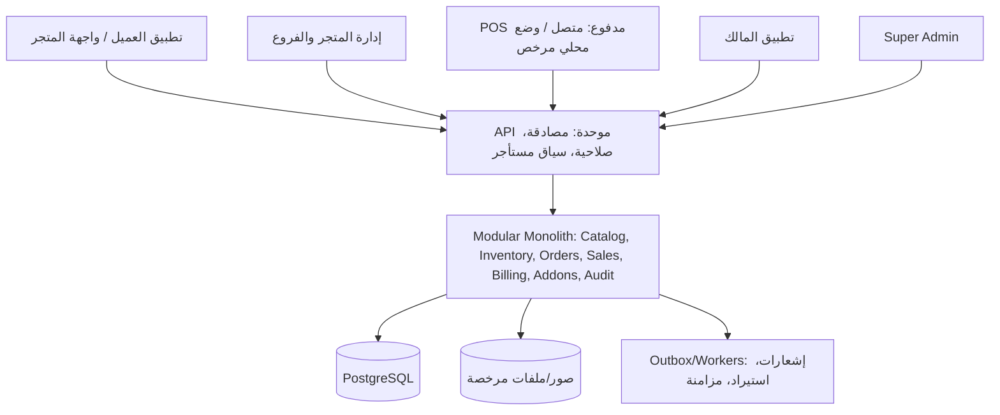
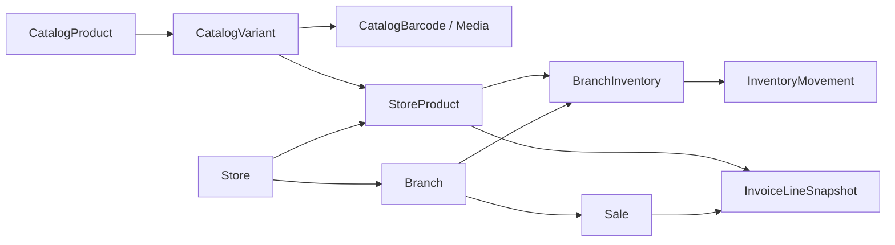

# التصور المعماري وعقود البيانات والتكامل — Supermarket SaaS

**الإصدار:** 3.0 | **الصفة:** معمارية مرجعية للاعتماد وليست وصفًا لكود منفذ

## 1. رسم حدود النظام

القصد **خمس تجارب وظيفية** وليس خمسة Backend أو خمس قواعد بيانات. يبدأ النظام من Backend واحد مقسم لوحدات، وتستخدم الواجهات نفس العقود مع فصل كامل للصلاحيات والبيانات.

## 2. مستويات فصل البيانات

- المستوى المركزي غير المملوك لتاجر: `CatalogProduct`, `CatalogVariant`, `CatalogBarcode`, `CatalogMedia`, `CatalogChange`, `CatalogReview`, `CatalogAlias`, `Category`, وبيانات باقات المنصة.
- حساب المستأجر والمتجر: `Tenant`, `Store`, `Membership`, `StoreProduct`, `StorePrice`, `Customer`, `Order`, `Subscription`, `StoreAddon`, `TenantAudit`.
- مستوى الفرع: `Branch`, `BranchInventory`, `InventoryMovement`, `StockCount`, `PurchaseReceipt`, `POSDevice`, `CashShift`, `Sale`.
- تاريخ مالي لا يكتب من جديد: `Invoice` و`InvoiceLineSnapshot`، `CashMovement`, `ReceivableEntry`, `StoreCreditEntry`, `PaymentConfirmation`.

**تنبيه:** أسماء الجداول مقترحة. يجب أن يقرر المهندس علاقات الربط، الفهارس، القيود، ومقاييس العزل بعد فحص الموجود؛ لا يُفرض إنشاء جدول جديد إذا كانت وظيفة مكافئة موجودة وصحيحة.

## 3. رسم العلاقة الأساسية

### ثوابت الهوية والعزل

1. `CatalogVariant.id` معرف غير قابل لإعادة الاستخدام لمنتج آخر؛ العلاقة تحافظ على النسخ التاريخية.
2. يحدد `StoreProduct` المتجر والنوع المركزي أو الخاص، ولا يعيد استخدام المعرف نفسه عبر متجرين.
3. قيود التفرد المقترحة: `(store_id, catalog_variant_id)` للسجلات المركزية الفعالة؛ و`(branch_id, store_product_id)` لرصيد الفرع، مع سياسة أرشفة/إعادة تفعيل مدروسة.
4. أي `BranchInventory` أو `InventoryMovement` يجب أن يعود إلى متجر يملك الفرع والمنتج فعلًا؛ **قيد قاعدة بيانات أو تحقق ذري** يجب أن يحمي هذه الحقيقة، وليس فحص واجهة فقط.
5. لا يُشتق سياق المستأجر من طلب المستخدم وحده. تُصمم واجهات API لجلب نطاق العضوية والتحقق من الدور والاستحقاق قبل العملية.
6. صور الكتالوج المركزي المنشورة عامة للمستفيدين المرخص لهم؛ صور متجر خاصة تحتاج فصل مساحة التخزين والسياسات وروابط التحميل.

## 4. معاملات الأعمال والاتساق

- **إضافة منتج من الكتالوج:** تحقق هوية + منشور/مسموح + `upsert` أو إدراج آمن برصيد أولي فقط إن لم يسبق الربط، ثم الحركة الافتتاحية في المعاملة نفسها؛ عند سباق عمليات يعالج التعارض بالقيد الفريد وبمفتاح idempotency.
- **بيع POS:** تحقق استحقاق POS وصلاحية الكاشير والفرع والوردية؛ تثبيت لقطة البنود/المبالغ، حركة المخزون، حركة النقد/الذمة، الفاتورة وحدث التدقيق كعملية متسقة. الفشل يترك أثر محاولة دون بيع نصف مكتمل.
- **مشتريات:** تأكيد الاستلام وتكلفة الكميات والحركات مرتبط بمعاملة؛ لا يضاف مخزون مرتين بتكرار النداء.
- **إلغاء/مرتجع:** مستند عكسي مرجعي؛ لا مسح بيع قديم ولا إعادة كتابة تكلفة/مبالغ سابقة.
- **استيراد جماعي:** `ImportJob` + بصمة/مفتاح عملية، وسجلات `ImportRowResult`. اعتماد مجموعة صفوف بشكل متسق وإظهار المقبول والمرفوض؛ عدم تكرار حركات المنتج نفسه عند إعادة محاولة.
- **تغيير كتالوج حساس:** سير مراجعة + مسودة تغيير + تقييم أثر + نشر إصدار + سجل تدقيق. تستمر الفواتير في قراءة نسخها الأصلية.

## 5. المال والكميات والدقة

- استخدام Decimal/تمثيل نقدي دقيق في قاعدة البيانات والمنطق، مع العملة والكسور/التقريب لكل عملية. عدم استخدام `number` عائم دون ضبط لحساب المال.
- الكميات تدعم الوزن والحبة والكرتون ومعامل تحويل موثق؛ تجنب تقريب الكميات بالكيلو عشوائيًا.
- فصل المخزون المسجل، والمحجوز، والمتاح، وقيد المزامنة عند الحاجة؛ تحديد سياسة خصم الطلب ومتى تعد المبيعات مؤكدة.
- تكلفة البضاعة لا تؤخذ من الكتالوج المرجعي؛ تحدد من مشتريات فعلية وسياسة تكلفة معتمدة؛ فصل FIFO المحاسبي عن FEFO التشغيلي.

## 6. تفاصيل تقنية قابلة للفحص

- Node.js/Express/TypeScript/Prisma/PostgreSQL مفضلة، لا تُفرض على مشروع قائم إذا كانت هجرة المنصة عالية الكلفة دون قيمة.
- React/Vite للويب؛ React Native/Expo للموبايل عند التحقق من متطلبات الإطلاق؛ مشاركة types/validation/API clients/UI primitives مع عزل الوصول.
- عقود OpenAPI تتضمن أخطاء محددة: 401 غير مصادق، 403 غير مخول، 409 تعارض/تكرار، 422 بيانات غير صالحة، ونتائج استيراد متعددة الصفوف.
- توثيق API ووحدات الخدمة: Catalog Search, Catalog Import/Review, Store Catalog Selection, Inventory, Orders, POS, Subscriptions, Addons, Audit.
- فهارس للباركود حسب النوع/النطاق، والعربية/الاسم البديل/العلامة، والعضوية والفرع؛ اختبارات أداء على حجم مرجعي تحدد قبل الإنشاء.
- خدمات خلفية للصور وفحص الملفات واستيراد دفعات كبيرة، مع مراقبة مهام تتوقف/تستأنف ومعرّف ارتباط للطلب.
- استخدام مفاتيح أسرار خارج المستودع، عمليات CI آمنة، نسخ احتياطية واستعادة مختبرة، مراقبة أخطاء وتكلفة وتشغيل.

## 7. تصميم Offline POS (مشروط بالاعتماد)

- تنزيل مجموعة أصناف وأسعار *خاصة بالمتجر والفرع والجهاز*، بإصدار ووقت صلاحية، بعد التحقق من استحقاق POS.
- إجراء البيع النقدي المسموح به محليًا مع `device_id`, `shift_id`, `local_transaction_id`, لحظة الإنشاء، بنود وفاتورة محلية مميزة بأنها غير مرحّلة للخادم.
- المزامنة عند عودة الشبكة بمفتاح فريد ومعاملة خادم؛ كل حدث إقرار أو رفض أو تعارض موثق. العميل لا يُظهر «مزامن» حتى يتلقى تأكيد الخادم.
- تعارض المخزون بين أجهزة متباعدة لا يحل بالكتابة الأخيرة؛ يعرض تقرير تسوية مع صلاحية، ويمنع إخفاء سحب المخزون المضاعف.
- لا بيع آجل/محفظة أو مرتجع حساس خارج الاتصال دون قرار خاص وتحليل خطر؛ مصير العمليات عند انتهاء الاشتراك/فقد الجهاز يجب تحديده مسبقًا.

## 8. الحد الأدنى من التهديدات والاختبارات

- هجوم استبدال `storeId` في API والملفات والتقارير؛ تلاعب `catalog_variant_id` أو قيمة السعر/الكمية من الاستيراد؛ ربط متجر بفرع لا يملكه؛ وصول catalog_editor إلى فواتير تاجر.
- استيراد CSV يحوي صيغ خبيثة أو حقول باركود تبدأ بـ`0` أو أسماء عربية مشوهة؛ صور بلا تصريح أو بروابط إلى موارد ضارة.
- السباق: عمليتا استيراد للصنف ذاته، مسح مكرر، إعادة إرسال البيع مع تعطل الاستجابة، مرتجع مضاعف، تحديث سعر أثناء تحصيل بيع.
- انقطاع الإنترنت والعمليات المحلية غير المرحّلة؛ انهيار جهاز أثناء البيع؛ صلاحية خدمة منتهية أثناء عمل أوفلاين؛ تغيير غير مشروع في ملف التخزين المحلي.

## 9. حدود الاستقلال القانوني والتجاري

الرخص البرمجية والمواد البصرية وقواعد البيانات المجمعة تحتاج تقييمًا منفصلًا؛ لا تعتمد أن رخصة مستودع مفتوح المصدر تسمح بجلب صوره التجارية أو استيراد قاعدة بيانات علامات تجارية من جهة ثالثة.

**شرط الاعتماد:** لا تُختار المعمارية النهائية ولا تكتب الترحيلات حتى تتم مراجعة المستودع الموجود بعد تفويض قراءة صريح واعتماد قرارات العمل الحرجة.